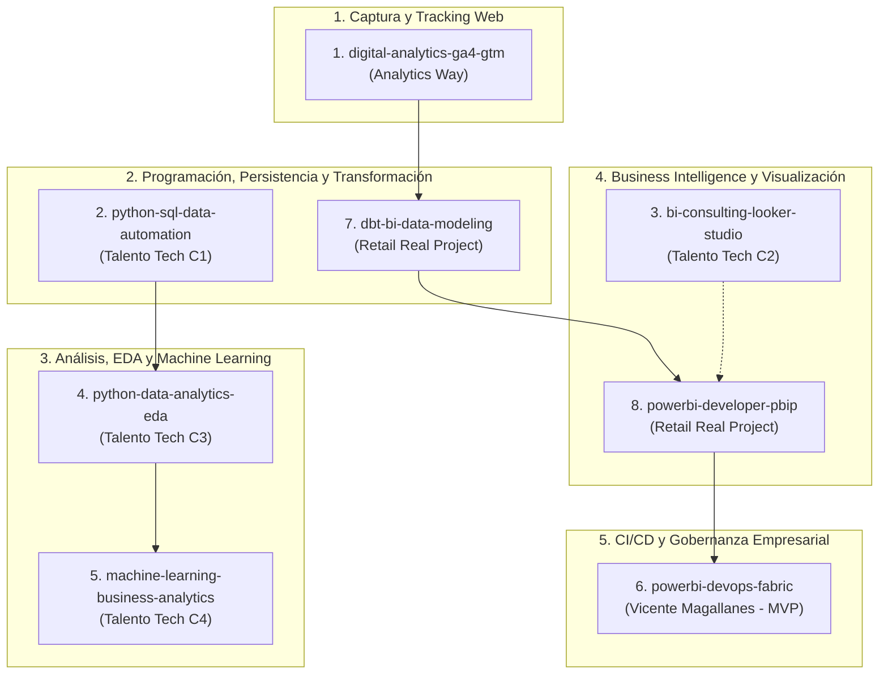

# MASTER SKILLS MANIFEST & BLUEPRINT
## Suite Oficial de Data Analytics & BI Skills

**Propietario / Autor:** Rubén David Barrios Bello  
**Perfil Profesional:** Data Analyst & BI Developer (Analítica de Datos, Business Intelligence, DevOps para BI y Analítica Digital)  
**Fecha de Emisión:** Noviembre 2026  
**Repositorio Local:** `C:\Users\ismar\OneDrive\Documents\Repositorios\antigravity-data-bi-skills`  
**Ubicación Global de Skills (Antigravity):** `C:\Users\ismar\.gemini\config\skills\`  

---

## 1. REGLAS FUNDAMENTALES DE IMPLEMENTACIÓN (MANDATORIO)

Al abrir una nueva ventana o sesión en este repositorio, el agente **DEBE SEGUIR ESTRICTAMENTE ESTAS 4 REGLAS**:

1. **SIN INVENTAR NADA:** Todo el contenido de cada skill debe estar 100% fundamentado en los programas de estudio, lecciones, certificaciones y proyectos reales guardados en la carpeta `docs/` y en este manifiesto.
2. **CREACIÓN UNA A UNA:** Nunca crear múltiples skills de golpe. Desarrollar la Skill 1 de forma completa y profunda, validarla con el usuario, y solo tras su confirmación avanzar a la siguiente.
3. **DOBLE DESTINO (ORDENADOR Y GITHUB):**
   - **Local para GitHub:** `skills/<skill_name>/` (dentro de este repositorio, con su `SKILL.md`, `references/`, `scripts/` y `examples/`).
   - **Global para Antigravity:** `C:\Users\ismar\.gemini\config\skills/<skill_name>/` (para que el agente las cargue automáticamente en cualquier proyecto futuro).
4. **ESTRUCTURA ESTÁNDAR DE CADA SKILL:**
   Cada skill debe contener:
   - `SKILL.md`: Metadata YAML frontal (`name`, `description`), directrices operativas, árboles de decisión, flujos de trabajo paso a paso, antipatrones a evitar y reglas de verificación.
   - `references/`: Guías de sintaxis rápida, checklists y documentación técnica de apoyo.
   - `scripts/`: Scripts en Python/PowerShell/SQL reutilizables listos para ejecutar.
   - `examples/`: Plantillas de código reales o configuraciones probadas.

---

## 2. INVENTARIO COMPLETO DE LAS 8 SKILLS A CONSTRUIR



---

## 3. DETALLE CURRICULAR Y EVIDENCIA DOCUMENTAL POR SKILL

### SKILL 1: `digital-analytics-ga4-gtm`
* **Fuente Oficial:** Certificación Analytics Way (Lorena Flores Saldías – Google Certified Educator). Emitido: 31/08/2026. Documento: `docs/Certificado_AnalyticsWay_GA4_GTM.png`.
* **39 Lecciones Prácticas Acreditadas:**
  1. ¿Qué es la Analítica Digital?
  2. Herramientas principales del ecosistema digital.
  3. Identificación de Objetivos de Negocio y KPIs.
  4. Creación de cuenta GA4, propiedad y flujo de datos (Web / App).
  5. Interfaz de Administrador y configuración de retención de datos.
  6. Instalación técnica de GA4 mediante Google Tag Manager (GTM).
  7. Definición de qué medir (Arquitectura de eventos).
  8. Plan de Medición corporativo (Measurement Plan).
  9. Dimensiones y Métricas (Alcance: Evento, Usuario, Sesión, Ítem).
  10. Tipos de eventos: Recogidos automáticamente, Medición mejorada, Recomendados y Personalizados.
  11. Eventos personalizados, variables de capa de datos (DataLayer) y parámetros.
  12. Creación de Reportes Personalizados en Exploraciones de GA4.
  13. Exportación y compartición de informes.
  14. Creación de Segmentos y Audiencias avanzadas.
  15. Introducción a la Analítica de E-commerce.
  16. Guía de Implementación Técnica (GIT) de E-commerce.
  17. Análisis exhaustivo del DataLayer de E-commerce (view_item_list, view_item, add_to_cart, begin_checkout, purchase).
  18. Configuración de Eventos de E-commerce en GTM.
  19. Plantilla de Contenedor de GTM preconfigurado.
  20. Adaptación para CMS: WooCommerce, Shopify, Magento.
  21. Variables y eventos con Custom JavaScript en GTM.
  22. Parámetros UTM y modelos de atribución en GA4.
  23. Integración del Píxel de Meta (Facebook Ads) vía GTM.
  24. Configuración de conversiones de Google Ads vía GTM.
  25. Interpretación de métricas y extracción de insights de negocio.
  26. Checklist de migración definitiva UA -> GA4.
  27. Conexión nativa de GA4 con Looker Studio.
  28. Gráficos principales en Looker Studio para GA4.
  29. Estilos, formas y temas ejecutivos en Looker Studio.
  30. Plantillas prediseñadas en Looker Studio.
  31. Caso Práctico 1: Tienda Online de Ropa (E-commerce B2C).
  32. Caso Práctico 2: Tienda Online de Productos Físicos.
  33. Caso Práctico 3: Sitio Web Corporativo (Captación de Leads / Formularios).
  34. Consent Mode v2: Marco regulatorio de privacidad europeo (EEA/GDPR).
  35. Consent Mode v2: Modo Básico vs Modo Avanzado.
  36. Consent Mode v2: Implementación técnica en GTM con CMPs (Cookiebot / Iubenda).
  37. GTM Server-Side: Introducción a la medición desde el servidor (First-party context).
  38. GTM Server-Side: Configuración del contenedor de servidor en Cloud Run / App Engine.
  39. GTM Server-Side: Envío de eventos desde el cliente hacia el servidor y despacho a GA4.

---

### SKILL 2: `python-sql-data-automation`
* **Fuente Oficial:** Talento Tech – Ministerio de Educación de la Ciudad de Buenos Aires. 80 horas reloj. Julio 2026. Documento: `docs/Talento_Tech_Iniciacion_Python.pdf` y `docs/Certificado_TalentoTech_Python.jpg`.
* **Contenido Temático (16 Clases / Cuatrimestre 1):**
  - Sintaxis fundamental, tipos de datos, estructuras de control (`if/elif/else`, bucles `for`, `while`).
  - Colecciones estructuradas: Listas, Tuplas, Diccionarios y Conjuntos. Métodos y comprensión de listas.
  - Modularidad: Definición de funciones (`def`), parámetros opcionales, `*args`, `**kwargs`, ámbito de variables.
  - Creación de módulos propios, organización de paquetes y reutilización de código.
  - Módulos estándar (`datetime`, `os`, `sys`, `random`) y librerías de consola (`colorama`).
  - Persistencia de datos: Lectura y escritura de archivos de texto y CSV.
  - Base de Datos SQLite3: Conexión con `sqlite3`, creación de tablas DDL, transacciones seguras (commit/rollback).
  - Operaciones CRUD completas (Create, Read, Update, Delete) con consultas parametrizadas obligatorias (prevención estricta de Inyección SQL).
  - Proyecto Integrador: Sistema modular por capas de automatización y gestión de datos con CLI.

---

### SKILL 3: `bi-consulting-looker-studio`
* **Fuente Oficial:** Talento Tech – Plan de Estudios 2026 (20 semanas / 16 clases). Documento: `docs/Talento_Tech_Consulting_BI.pdf`.
* **Contenido Temático (Cuatrimestre 2):**
  - Introducción al Business Intelligence y rol del consultor de datos. Alineación de objetivos de negocio con métricas clave.
  - Ética y Seguridad de Datos: Privacidad, anonimización, cumplimiento normativo y gobernanza.
  - Obtención y Calidad de Datos: Identificación de fuentes, consistencia, completitud y validación.
  - Preparación y Modelado en Hojas de Cálculo (Google Sheets avanzado): Fórmulas matriciales, tablas dinámicas, cruce de datos (`BUSCARV`, `INDEX/MATCH`, `QUERY`).
  - Estadística Descriptiva Básica aplicada al negocio: Medidas de tendencia central, dispersión, percentiles y distribuciones.
  - Creación de Reportes e Informes Ejecutivos.
  - Diseño de Dashboards Interactivos en Looker Studio: Filtros dinámicos, controles de parámetros, campos calculados (`CASE WHEN`).
  - Reducción de la Carga Cognitiva y Principios Gestalt aplicados al diseño de dashboards.
  - Storytelling con Datos: Estructura narrativa (contexto, conflicto, resolución), presentación de hallazgos ejecutivos a directivos con Google Slides.
  - Proyecto Integrador de Consultoría BI: Caso de negocio integral de extremo a extremo.

---

### SKILL 4: `python-data-analytics-eda`
* **Fuente Oficial:** Talento Tech – Plan de Estudios 2025 (1 cuatrimestre / 16 clases). Documento: `docs/Talento_Tech_Data_Analytics.pdf`.
* **Contenido Temático (Cuatrimestre 3):**
  - Entorno de trabajo analítico en Google Colab y Jupyter Notebooks.
  - Computación Numérica con **NumPy**: Arrays multidimensionales, vectorización, broadcasting y operaciones matriciales.
  - Manipulación y Wrangling de Datos con **Pandas**: `Series`, `DataFrame`, indexación avanzada, selección, filtrado y máscaras booleanas.
  - Limpieza de Datos: Detección y tratamiento de valores nulos (`NaN`), duplicados, conversión de tipos de datos y manejo de fechas.
  - Agrupaciones y Transformaciones: `groupby()`, `agg()`, tablas pivote (`pivot_table()`), combinaciones (`merge()`, `concat()`).
  - Análisis Exploratorio de Datos (EDA): Estadísticas univariadas, bivariadas y multivariadas. Matrices de correlación (Pearson, Spearman).
  - Visualización Estática: **Matplotlib** y **Seaborn** (histogramas, boxplots, diagramas de dispersión, heatmaps de correlación, pairplots).
  - Visualización Interactiva: **Plotly Express** para gráficos exploratorios interactivos con tooltips y zoom.
  - Proyecto Integrador: Informe EDA completo sobre dataset de negocio real con detección de patrones y anomalías.

---

### SKILL 5: `machine-learning-business-analytics`
* **Fuente Oficial:** Talento Tech – Plan de Estudios 2026 (20 semanas / 16 clases). Documento: `docs/Talento_Tech_Machine_Learning.pdf`.
* **Contenido Temático (Cuatrimestre 4):**
  - Fundamentos del Aprendizaje Automático: Aprendizaje Supervisado vs No Supervisado vs Aprendizaje por Refuerzo.
  - Ciclo de vida de un proyecto de ML: Del problema de negocio a la inferencia.
  - Preprocesamiento Avanzado y Feature Engineering con **Scikit-Learn**:
    - Escalado y normalización (`StandardScaler`, `MinMaxScaler`).
    - Codificación de variables categóricas (`OneHotEncoder`, `OrdinalEncoder`).
    - Imputación avanzada (`SimpleImputer`, `KNNImputer`).
  - Modelos de Regresión: Regresión Lineal, Regresión Múltiple, Métricas de evaluación ($R^2$, RMSE, MAE).
  - Modelos de Clasificación: Regresión Logística, Árboles de Decisión, Random Forest. Métricas de evaluación (Matriz de confusión, Accuracy, Precision, Recall, F1-Score, Curva ROC-AUC).
  - Modelos No Supervisados: Clustering con **K-Means**, método del codo (Elbow Method) y Coeficiente de Silueta para segmentación de clientes/productos.
  - Validación y Optimización: Validación cruzada (`K-Fold`), ajuste de hiperparámetros con `GridSearchCV` y `RandomizedSearchCV`.
  - Construcción de Pipelines robustos (`Pipeline`, `ColumnTransformer`) para evitar Data Leakage.
  - Proyecto Integrador: Modelo predictivo de clasificación o regresión con entrega de informe y métricas de impacto comercial.

---

### SKILL 6: `powerbi-devops-fabric`
* **Fuente Oficial:** Formación Especializada por Vicente Antonio Juan Magallanes (Microsoft MVP en Power Platform, PL-300, DP-600, Fabric Analytics Engineer). Documento: `docs/Curso_PowerBI_DevOps_Vicente_Magallanes.jpg`.
* **Contenido Temático Profesional:**
  - Filosofía DevOps aplicada al ciclo de vida de Business Intelligence.
  - Formato Power BI Project (**PBIP**) y arquitectura de carpetas (`.SemanticModel` y `.Report`).
  - Control de versiones con **Git** adaptado a modelos de datos y reportes: Ramificación (Git Flow: `main`, `develop`, `feature/*`), Pull Requests, code review y resolución de conflictos de merge.
  - Integración de repositorios con **Azure DevOps Repos** y **GitHub**.
  - Automatización de despliegues con **Pipelines CI/CD** basados en ficheros YAML:
    - Creación y configuración de Azure Pipelines.
    - Configuración de Agentes Self-Hosted y Microsoft-Hosted.
    - Autenticación segura mediante Service Principals y App Registrations en **Microsoft Entra ID** (Azure AD).
  - Integración con **Microsoft Fabric**:
    - Conexión nativa de Workspaces de Fabric con Git.
    - Deployment Pipelines (Canalizaciones de implementación) de Fabric (Entornos DEV -> TEST -> PROD).
    - Despliegue automatizado de Modelos Semánticos y Reportes sin intervención manual.
  - Gestión de incidencias, trazabilidad completa y tableros en Azure Boards.

---

### SKILL 7: `dbt-bi-data-modeling`
* **Fuente Oficial:** Proyecto Empresarial Real Retail Analytics (dbt Core + Google BigQuery).
* **Contenido Temático:**
  - Modelado Dimensional Kimball para arquitecturas de Data Warehouse modernas: Tablas de Hechos (Fact Tables) y Tablas de Dimensiones (Dimension Tables: Tipo 1 y Tipo 2 SCD).
  - Estructuración de capas dbt: `staging` (fuentes sin procesar, casteos básicos), `intermediate` (reconciliaciones de negocio, agregaciones) y `marts` (modelos dimensionales listos para consumo).
  - Optimización y FinOps en **Google BigQuery**:
    - Estrategias de particionamiento por fecha de transacción (`partition by date`).
    - Estrategias de clustering por atributos de alta cardinalidad (`cluster by customer_id, store_id`).
    - Reducción de costos de consulta y tiempos de escaneo en queries de alta escala.
  - Aseguramiento de Calidad de Datos (dbt Tests):
    - Pruebas genéricas obligatorias (`unique`, `not_null`, `relationships` de integridad referencial, `accepted_values`).
    - Pruebas singulares de reconciliación contable: Validación de que `Venta Bruta - Descuentos - Devoluciones - Cancelaciones = Venta Neta`.
  - Documentación viva y linaje de datos con `dbt docs generate`.

---

### SKILL 8: `powerbi-developer-pbip`
* **Fuente Oficial:** Proyecto Empresarial Real Dashboard Ejecutivo Retail Analytics DAX + HTML + CSS.
* **Contenido Temático:**
  - Arquitectura PBIP de bajo nivel: Control manual de TMDL (`Tabular Model Definition Language`) y PBIR (`Power BI Report Format`).
  - Reglas críticas de compilación TMDL:
    - Codificación obligatoria **UTF-8 sin BOM**. Eliminación estricta del encabezado BOM (`0xEF, 0xBB, 0xBF`) para evitar el error fatal de Analysis Services.
    - Sintaxis de expresiones multilínea: Delimitación estricta con exactamente 3 comillas invertidas (```` ``` ````).
  - Arquitectura de Canvas y Grilla Ejecutiva 1920x1080: Alineación milimétrica por coordenadas (`x, y, width, height`), márgenes y gutters estructurados.
  - Diseño DAX Avanzado con Motor Gráfico HTML/CSS/SVG:
    - Creación de tarjetas KPI dinámicas con SVG nativo generado por DAX (sparklines, barras de progreso, variaciones porcentuales).
    - Efecto 3D Dual Flip interactivo: Animación de giro de 180° en CSS puro mediante `:hover` y persistencia al clic mediante checkbox oculto `:checked`.
    - Lógica de Storytelling y diagnóstico en el reverso de cada visual con narrativa ejecutiva automática en DAX.
  - Automatización y Diagnóstico en Vivo:
    - Conexión a la instancia local de Analysis Services de Power BI Desktop mediante puertos dinámicos (`msmdsrv.exe`).
    - Ejecución de queries DAX por consola mediante PowerShell / Python con ADOMD.NET / AMO.

