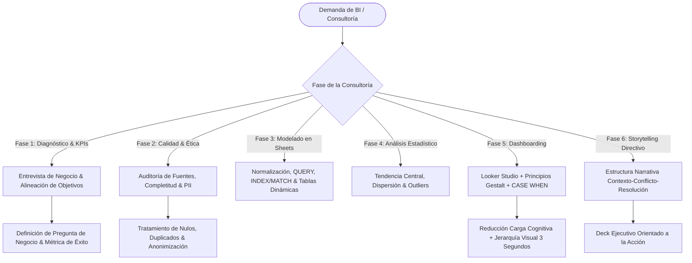

# Business Intelligence Consulting, Looker Studio & Executive Storytelling

## Propósito y Alcance Operativo
Esta skill guía al agente en la consultoría estratégica de Business Intelligence. Abarca el ciclo completo de transformación de datos: desde la identificación de necesidades y alineación de KPIs con la dirección, auditoría de calidad y ética de datos, preparación analítica en Google Sheets (fórmulas complejas, `QUERY`, modelado matricial), análisis estadístico descriptivo, hasta el diseño ergonómico de tableros interactivos en **Looker Studio** aplicando leyes de percepción visual (**Gestalt**) y la estructuración de narrativas ejecutivas (**Storytelling con datos**) para la toma de decisiones.

---

## 1. Árbol de Decisión Operativo



---

## 2. Flujo de Trabajo Metodológico de Consultoría BI

### Fase 1: Diagnóstico de Negocio y Alineación Estratégica
1. **Identificación del Problema Real:**
   - Separar el "síntoma" (ej. "las ventas cayeron") de la "causa raíz" o pregunta analítica (ej. "¿qué canal o cohorte de clientes tiene menor retención?").
2. **Definición de KPIs según el Modelo SMART:**
   - Específicos, Medibles, Alcanzables, Relevantes y con Horizonte Temporal definido.
3. **Gobierno y Ética de Datos:**
   - Anonimización o seudonimización de información personal identificable (PII: DNI, correos, teléfonos).
   - Validación de consistencia y completitud antes de cualquier procesamiento visual.

---

### Fase 2: Preparación y Modelado Analítico en Google Sheets
1. **Estructura Tabular Estricta (Tidy Data):**
   - Una única fila por observación/transacción.
   - Una única columna por variable/atributo.
   - Encabezados en la fila 1 sin celdas combinadas (*merged cells*) para evitar romper conectores.
2. **Fórmulas Analíticas y Matriciales:**
   - Cruce seguro de dimensiones con `INDEX/MATCH` o `XLOOKUP` en lugar de `VLOOKUP` rígido.
   - Agregaciones complejas con la función `QUERY`:
     `=QUERY(Datos!A1:G1000, "SELECT B, SUM(E) WHERE G = 'Aprobado' GROUP BY B ORDER BY SUM(E) DESC LABEL SUM(E) 'Total Ventas'", 1)`
   - Vectorización con `ARRAYFORMULA` para evitar arrastrar fórmulas manualmente en miles de filas.

---

### Fase 3: Estadística Descriptiva Aplicada al Negocio
1. **Medidas de Tendencia Central:**
   - Media vs Mediana: Cuando la distribución de ingresos o montos tiene asimetría positiva o outliers severos, **la mediana** es la métrica de posición robusta obligatoria.
2. **Medidas de Dispersión y Posición:**
   - Rango intercuartílico (IQR), Desviación Estándar ($\sigma$) y Percentiles (P25, P50, P75, P90) para segmentación de clientes y análisis de dispersión operativa.
3. **Detección de Valores Atípicos (Outliers):**
   - Regla de Tukey ($[Q_1 - 1.5 \cdot IQR, Q_3 + 1.5 \cdot IQR]$) para auditar datos corrompidos o anomalías comerciales de alto impacto.

---

### Fase 4: Diseño Ergonómico en Looker Studio (Leyes Gestalt)
1. **Regla de los 3 Segundos:**
   - El tomador de decisiones debe comprender el estado general del negocio (salud de métricas principales) en los primeros 3 segundos de observar el tablero.
2. **Aplicación de Principios Gestalt:**
   - **Proximidad:** Elementos relacionados agrupados visualmente mediante contenedores o fondos sutiles.
   - **Semejanza:** Mismo color para la misma métrica a lo largo de todo el informe (ej. Ingresos siempre en azul corporativo, Costos en gris).
   - **Figura/Fondo y Contraste:** Uso de fondos neutros (blanco o gris claro `#F8F9FA`) con alto contraste para destacar anomalías (rojo/verde reservados únicamente para variaciones positivas/negativas).
3. **Campos Calculados Estratégicos (`CASE WHEN`):**
   - Clasificación de clientes por ticket promedio:
     ```sql
     CASE 
       WHEN Monto >= 1000 THEN 'Tier 1 - Alto Valor'
       WHEN Monto >= 500 THEN 'Tier 2 - Medio'
       ELSE 'Tier 3 - Base'
     END
     ```
   - Normalización de canales o creación de ratios porcentuales dinámicos.

---

### Fase 5: Storytelling con Datos y Presentación Directiva
1. **La Estructura Narrativa de Consultoría:**
   - **Contexto:** Estado de situación y metas acordadas del negocio.
   - **Conflicto (El Hallazgo / Clímax Analítico):** La desviación crítica, anomalía o cuello de botella detectado en los datos.
   - **Resolución (Recomendación Accionable):** Propuestas concretas de acción basadas en los hallazgos con impacto económico estimado.
2. **Reglas para Diapositivas Ejecutivas (Google Slides):**
   - Máximo un mensaje clave por gráfico/pantalla.
   - Encabezados informativos accionables: En vez de "Evolución de Ventas 2026", usar "Las ventas cayeron 14% en Q3 debido a la pérdida de clientes corporativos".

---

## 3. Antipatrones Críticos a Evitar

| Antipatrón | Consecuencia en el Negocio | Corrección Mandatoria |
| :--- | :--- | :--- |
| **Tableros "árbol de navidad"** (demasiados colores y fuentes) | Sobrecarga cognitiva y parálisis por análisis. | Paleta monocromática corporativa con 1 solo color de acento. |
| **Celdas combinadas en hojas fuente** | Rotura de los conectores nativos de Looker Studio. | Estructura tabular estricta (1 fila por registro, sin merge). |
| **Usar la media en datos altamente sesgados** | Conclusiones distorsionadas por valores extremos. | Reportar siempre la mediana acompañada del IQR o percentiles. |
| **Títulos de gráficos puramente descriptivos** | El directivo no extrae el insight ni sabe qué acción tomar. | Usar títulos con narrativa orientada al hallazgo de negocio. |
| **Gráficos de tarta (Pie Charts) con más de 3 categorías** | Imposibilidad visual de comparar ángulos con precisión. | Reemplazar por gráficos de barras horizontales ordenados de mayor a menor. |

---

## 4. Checklist de Aprobación de un Dashboard de BI

1. ¿Las tarjetas KPI resumen las métricas clave en la parte superior izquierda?
2. ¿Los filtros temporales y categóricos afectan armónicamente a todos los gráficos de la página?
3. ¿Todos los números tienen formato adecuado (moneda, separadores de miles y decimales acotados a 1 o 2 dígitos)?
4. ¿Los colores de advertencia (rojo/verde) se utilizan exclusivamente para variaciones favorables/desfavorables de negocio?
5. ¿Los campos calculados manejan divisiones por cero con funciones de contingencia o `NULLIF`?

