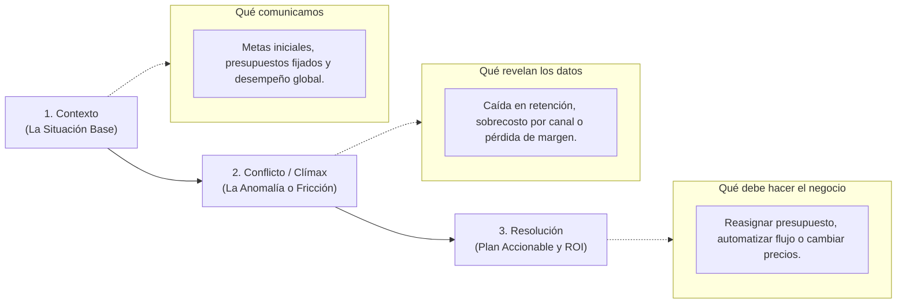

# Framework de Storytelling con Datos y Comunicación Directiva

Un análisis técnico brillante carece de valor si no logra persuadir a la dirección general para tomar medidas concretas. El Storytelling con datos transforma métricas frías en una narrativa estructurada orientada a la acción.

---

## 1. La Estructura Narrativa en 3 Actos (Consultoría BI)

---

## 2. Reglas de Redacción para Títulos y Diapositivas (Action Titles)

Los ejecutivos leen los títulos de las diapositivas primero. Si el título no transmite el hallazgo, la diapositiva falla.

| Título Pasivo (Descriptivo / Antipatrón) | Título Accionable (Storytelling con Datos) |
| :--- | :--- |
| *Evolución mensual de ventas en 2026* | **Las ventas crecieron 18% interanual impulsadas por la línea Enterprise.** |
| *Distribución geográfica de clientes* | **El 62% de la facturación depende exclusivamente de 3 provincias.** |
| *Tasa de abandono de formularios* | **El paso 2 del checkout pierde el 45% de los leads debido a campos redundantes.** |
| *Costo por Adquisición por canal publicitario* | **Meta Ads triplicó su CPA; se recomienda reasignar presupuesto a Google Search.** |

---

## 3. La Regla del "So What?" (¿Y qué?)

Ante cada gráfico, tabla o cálculo presentado, el analista debe responderse tres preguntas consecutivas antes de proyectarlo al comité:

1. **¿Qué muestra el dato?** (El hecho objetivo).
   - *Ejemplo: La tasa de conversión en dispositivos móviles es 1.1% vs 3.4% en Desktop.*
2. **¿Y qué significa para el negocio?** (El impacto económico).
   - *Ejemplo: Significa que perdemos $45,000 USD mensuales en tráfico pagado que entra por celulares.*
3. **¿Qué hacemos al respecto?** (La recomendación).
   - *Ejemplo: Optimizar la velocidad del checkout móvil y habilitar Apple Pay / Google Pay de un clic.*

