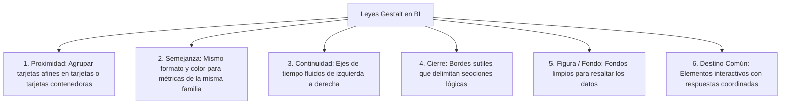

# Principios de Diseño Gestalt y Reducción de Carga Cognitiva en BI

El cerebro humano procesa imágenes antes que texto o números. Diseñar dashboards aplicando los principios de la psicología de la **Gestalt** garantiza que los ejecutivos identifiquen patrones y anomalías en menos de 3 segundos sin sobrecarga mental.

---

## 1. Las 6 Leyes Gestalt Aplicadas a Dashboards

### 1.1. Ley de Proximidad
- Los objetos que están cerca unos de otros se perciben como un grupo homogéneo.
- **En la práctica:** Agrupar en un mismo contenedor o cuadrante las métricas comerciales (Ingresos, Margen, Ticket Promedio) y separar de las métricas logísticas (Tiempos de entrega, Envíos pendientes).

### 1.2. Ley de Semejanza
- Los elementos que comparten características visuales (color, forma, tipografía) se interpretan con el mismo significado.
- **En la práctica:** Si las ventas históricas se muestran con barras azules `#1A73E8`, nunca pintar los costos del mismo azul en el siguiente gráfico. Los costos deben tener un color secundario (ej. gris `#5F6368`).

### 1.3. Ley de Figura y Fondo
- El ojo distingue claramente entre el objeto principal (los datos) y el fondo.
- **En la práctica:** Utilizar fondos neutros (blancos `#FFFFFF` o grises muy suaves `#F8F9FA`). Evitar gradientes, sombras pesadas o marcas de agua que compitan visualmente con las líneas y barras de datos.

### 1.4. Ley de Cierre
- El cerebro completa las figuras incompletas.
- **En la práctica:** No se requieren líneas divisorias gruesas o bordes negros para separar gráficos; un margen en blanco uniforme (*gutters*) o una tarjeta con borde gris muy sutil (`#E0E0E0`) es suficiente.

---

## 2. Tipos de Carga Cognitiva según John Sweller

1. **Carga Intrínseca:** El esfuerzo inherente a la complejidad del problema de negocio que se está analizando. No se puede eliminar, pero se puede estructurar.
2. **Carga Pertinente (Germana):** El procesamiento mental dedicado a construir modelos y extraer insights reales de los datos. **Es la que deseamos maximizar.**
3. **Carga Extraña (Extraneous):** El esfuerzo innecesario causado por mal diseño, fuentes ilegibles, exceso de colores, gráficos 3D absurdos o cuadrículas sobrecargadas. **Debe reducirse a cero.**

---

## 3. Guía de Selección de Visualizaciones

| Pregunta de Negocio | Tipo de Relación | Gráfico Mandatorio | Gráfico Prohibido |
| :--- | :--- | :--- | :--- |
| ¿Cuál es el valor acumulado o estado actual? | Indicador Clave | Tarjeta de Resultados (Scorecard / KPI Card) | Tablas gigantes sin destacar el total |
| ¿Cómo evolucionó la métrica en el tiempo? | Tendencia Temporal | Gráfico de Líneas continuo | Gráficos circulares o barras dispersas |
| ¿Quiénes son los 10 mejores clientes o productos? | Comparación de Magnitud | Gráfico de Barras horizontales ordenado | Gráfico de tarta (pie) con 10 sectores |
| ¿Qué proporción representa cada canal? ($\le 3$ categorías) | Parte de un Todo | Gráfico de Anillo (Donut) con 2 o 3 sectores | Gráficos 3D o con más de 4 categorías |
| ¿Existe correlación entre precio y volumen? | Relación Bivariada | Diagrama de Dispersión (Scatter Plot) | Gráficos de áreas apiladas |
| ¿Cómo se distribuyen los salarios o tickets? | Distribución | Histograma o Diagrama de Caja (Boxplot) | Gráfico de líneas discontinuo |

