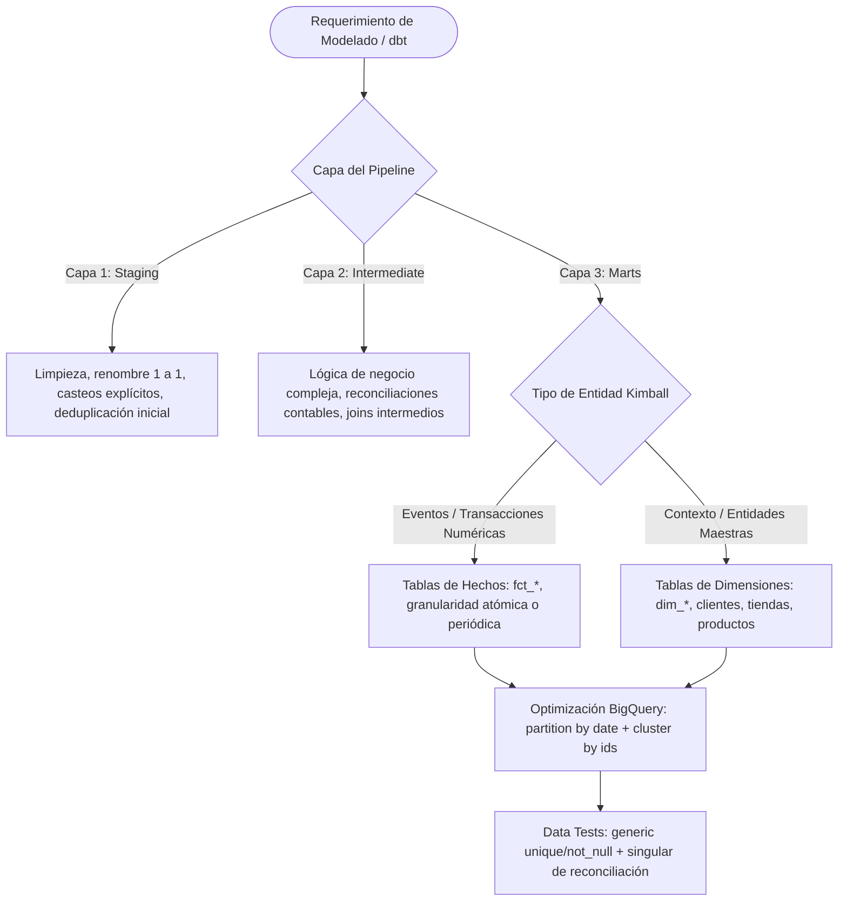

# dbt Data Modeling & BigQuery FinOps for Business Intelligence

## Propósito y Alcance Operativo
Esta skill capacita al agente para diseñar, implementar y gobernar pipelines analíticos de transformación con **dbt Core** sobre **Google BigQuery**, orientados a servir modelos analíticos confiables a herramientas de BI (Power BI, Looker Studio). Se fundamenta en las prácticas reales de ingeniería aplicadas en proyectos de Retail Analytics: modelado dimensional de Kimball (Hechos y Dimensiones), arquitectura estricta de capas (`staging`, `intermediate`, `marts`), optimización de costos y rendimiento en BigQuery (particionado por fecha y clustering), aseguramiento continuo de calidad de datos (*generic & singular data tests*) y documentación de linaje.

---

## 1. Árbol de Decisión Operativo



---

## 2. Flujo de Trabajo Metodológico (Paso a Paso)

### Fase 1: Arquitectura de Tres Capas en dbt

```
models/
├── staging/       --> Vistas o tablas ligeras. Espejo limpio de las fuentes raw.
├── intermediate/  --> Tablas efímeras o intermedias. Transformaciones de negocio antes del modelado final.
└── marts/         --> Tablas/Vistas dimensionales de consumo final para analistas y tableros BI.
```

1. **Capa Staging (`models/staging/`):**
   - **Objetivo:** Aislar el Data Warehouse de la volatilidad del origen.
   - **Reglas:**
     - Materialización por defecto: `view`.
     - Renombrar campos a nomenclatura estandarizada en `snake_case`.
     - Casteos de tipo explícitos (`cast(created_at as timestamp)`).
     - Prohibido hacer `JOIN` entre diferentes fuentes en esta capa.
     - Una carpeta por origen (`staging/erp/`, `staging/ecommerce/`).
2. **Capa Intermediate (`models/intermediate/`):**
   - **Objetivo:** Resolver lógica de negocio compartida y preparación dimensional.
   - **Reglas:**
     - Resolver cálculos contables preliminares (ej. desglose de impuestos, descuentos y costos).
     - Cruce entre fuentes normalizadas.
     - Materialización: `view` o `ephemeral` si no se requiere persistencia física.
3. **Capa Marts (`models/marts/`):**
   - **Objetivo:** Exponer el modelo dimensional Kimball optimizado para analítica y BI.
   - **Reglas:**
     - Prefijo estricto: `fct_<proceso>` para tablas de hechos (ej. `fct_ventas_diarias`) y `dim_<entidad>` para dimensiones (ej. `dim_clientes`).
     - Granularidad documentada y explícita (ej. "una fila por ítem vendido en cada orden").
     - Materialización: `table` o `incremental`.

---

### Fase 2: Optimización y FinOps en Google BigQuery
BigQuery cobra por volumen de datos escaneados en consultas bajo el modelo bajo demanda (*On-Demand*). La optimización del modelo dbt es la primera línea de defensa contra sobrecostos:

1. **Estrategia de Particionamiento (`partition_by`):**
   - Toda tabla de hechos volumétrica con dimensión temporal debe particionarse por fecha:
     ```sql
     {{ config(
         materialized='table',
         partition_by={
           "field": "fecha_transaccion",
           "data_type": "date",
           "granularity": "day"
         }
     ) }}
     ```
   - *Beneficio:* Una consulta de Power BI que filtre por el último mes escanea únicamente las particiones correspondientes, evitando procesar el histórico de años anteriores.
2. **Estrategia de Clustering (`cluster_by`):**
   - Complementar el particionamiento ordenando físicamente las filas por hasta 4 columnas de alta cardinalidad frecuentemente filtradas:
     ```sql
     {{ config(
         materialized='table',
         partition_by={"field": "fecha_transaccion", "data_type": "date", "granularity": "day"},
         cluster_by=["tienda_id", "cliente_id", "categoria_producto"]
     ) }}
     ```
   - *Regla de orden:* Colocar en la primera posición del array la columna con mayor cardinalidad o más común en los filtros `WHERE`.

---

### Fase 3: Aseguramiento de Calidad de Datos (dbt Tests)

1. **Pruebas Genéricas Obligatorias en `schema.yml`:**
   - Llaves primarias de dimensiones: `unique` y `not_null`.
   - Llaves foráneas en tablas de hechos: `relationships` apuntando a la dimensión correspondiente (integridad referencial).
   - Columnas categóricas críticas: `accepted_values` (ej. estados: `['completado', 'cancelado', 'pendiente']`).
2. **Pruebas Singulares de Reconciliación Contable (`tests/`):**
   - dbt considera que una prueba singular **falla si la consulta retorna al menos una fila**.
   - Ejemplo de prueba singular de auditoría de venta neta:
     ```sql
     -- Falla si la suma de componentes no coincide con la venta neta informada
     select
         transaccion_id,
         venta_bruta,
         descuento,
         devolucion,
         venta_neta,
         (venta_bruta - descuento - devolucion) as venta_neta_calculada
     from {{ ref('fct_ventas') }}
     where abs(venta_neta - (venta_bruta - descuento - devolucion)) > 0.01
     ```

---

### Fase 4: Documentación y Linaje
1. Definir descripciones claras a nivel de modelo y columna en archivos `.yml`.
2. Ejecutar `dbt docs generate` para producir el grafo acíclico dirigido (DAG) que visualice la trazabilidad de cada métrica desde la fuente hasta el mart final.

---

## 3. Antipatrones Críticos a Evitar

| Antipatrón | Consecuencia en BigQuery / BI | Corrección Mandatoria |
| :--- | :--- | :--- |
| **Referenciar tablas origen directamente con `FROM source_table`** | Ruptura del linaje de dbt y acoplamiento rígido a esquemas crudos. | Usar siempre `{{ source('origen', 'tabla') }}` en staging y `{{ ref('modelo') }}` en adelante. |
| **Crear tablas de hechos gigantes sin particionamiento** | Costos desmedidos de escaneo en cada actualización de dashboard. | Configurar `partition_by` por día sobre la fecha del evento. |
| **Hacer joins complejos en la capa Staging** | Duplicación de lógica y pérdida de claridad modular. | Staging solo limpia y tipa; los joins pertenecen a `intermediate` o `marts`. |
| **Ignorar llaves foráneas huérfanas en tablas de hechos** | Totales incorrectos en Power BI (*blank row* en dimensiones). | Aplicar test de `relationships` en el `schema.yml`. |
| **Usar `SELECT *` en modelos intermedios o marts** | Escaneos de columnas innecesarias y falta de control de esquema. | Declarar explícitamente cada columna requerida por el negocio. |

---

## 4. Checklist de Validación de Modelos dbt

1. ¿El modelo pertenece a una capa claramente definida (`staging`, `intermediate` o `marts`)?
2. ¿Se utilizan únicamente funciones `source()` o `ref()` para garantizar el linaje en el DAG?
3. ¿Las tablas de hechos tienen configurado `partition_by` por fecha y `cluster_by` por llaves de búsqueda?
4. ¿El archivo `schema.yml` contiene pruebas de `unique` y `not_null` para la llave primaria?
5. ¿Se implementó la prueba singular de consistencia contable en `tests/` para verificar la matemática del negocio?

