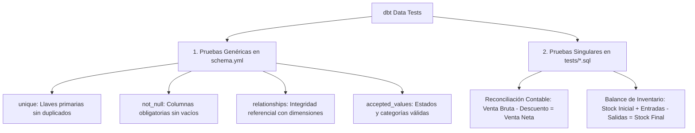

# Framework de Aseguramiento de Calidad y Reconciliación en dbt

Los errores en los datos que llegan a los dashboards destruyen la confianza de los directivos. El testing continuo en dbt detecta anomalías antes de que el reporte sea publicado.

---

## 1. Tipos de Pruebas en dbt



---

## 2. Configuración de Pruebas Genéricas (`schema.yml`)

```yaml
version: 2

models:
  - name: fct_sales_daily
    description: "Tabla de hechos de ventas diarias agregadas por tienda y producto."
    columns:
      - name: sale_key
        description: "Surrogate key única del hecho."
        tests:
          - unique
          - not_null

      - name: store_id
        description: "Llave foránea hacia dim_stores."
        tests:
          - not_null
          - relationships:
              to: ref('dim_stores')
              field: store_id

      - name: order_status
        description: "Estado operativo de la orden."
        tests:
          - accepted_values:
              values: ['completed', 'shipped', 'cancelled', 'refunded']
              config:
                severity: warn  # Alerta sin abortar el pipeline si aparece un estado nuevo
```

---

## 3. Pruebas Singulares de Reconciliación Contable

En dbt, las pruebas singulares son archivos `.sql` ubicados en el directorio `tests/`. **La prueba pasa si la consulta devuelve exactamente 0 filas**. Si devuelve registros, significa que se violó la regla contable.

### Ejemplo: Auditoría de Venta Neta y Descuentos
`tests/assert_net_sales_reconciliation.sql`:

```sql
/*
  Regla de Negocio:
  Venta Neta debe ser estrictamente igual a Venta Bruta menos Descuentos menos Devoluciones.
  Tolerancia admitida: 0.01 (para mitigar redondeos decimales).
*/

with auditoria as (
    select
        transaction_id,
        gross_sales,
        discount_amount,
        return_amount,
        net_sales,
        round(gross_sales - discount_amount - return_amount, 2) as calculated_net_sales
    from {{ ref('fct_sales_daily') }}
)

select
    transaction_id,
    gross_sales,
    discount_amount,
    return_amount,
    net_sales,
    calculated_net_sales,
    abs(net_sales - calculated_net_sales) as discrepancy
from auditoria
where abs(net_sales - calculated_net_sales) > 0.01
```

