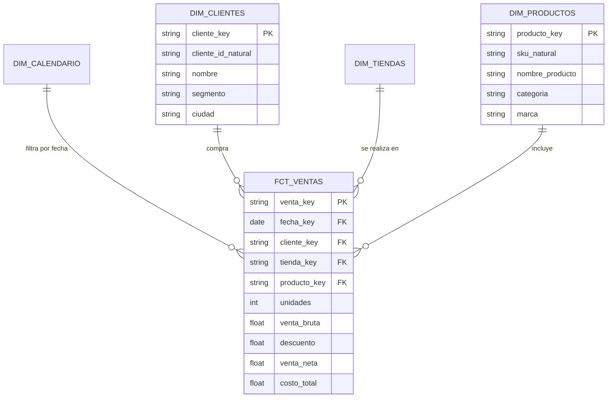

# Metodología de Modelado Dimensional Kimball para dbt y BI

El modelado dimensional introducido por Ralph Kimball sigue siendo el estándar más eficiente para responder preguntas de negocio y alimentar herramientas de BI como Power BI y Looker Studio.

---

## 1. Conceptos Fundamentales: Hechos vs Dimensiones



### A. Tablas de Hechos (Fact Tables)
- **Definición:** Contienen métricas numéricas cuantitativas resultantes de un evento o proceso de negocio (ej. una transacción de venta, una devolución, un inventario a fin de mes).
- **Características:**
  - Granularidad atómica: La unidad mínima e indivisible que representa una fila (ej. *un ítem dentro de un ticket de compra*).
  - Llaves foráneas: Múltiples columnas que apuntan a tablas de dimensiones.
  - Medidas aditivas: Métricas que pueden sumarizarse válidamente a través de cualquier dimensión (ej. `monto_total`, `unidades`).

### B. Tablas de Dimensiones (Dimension Tables)
- **Definición:** Proveen el contexto descriptivo ("quién, qué, dónde, cuándo y por qué") de los eventos registrados en las tablas de hechos.
- **Características:**
  - Columnas de texto, atributos cualitativos y jerarquías (ej. `Categoría > Subcategoría > Producto`).
  - Menor volumen de registros que las tablas de hechos, pero mayor cantidad de atributos descriptivos (tablas "anchas").

---

## 2. Llaves Sustitutas (Surrogate Keys) en dbt
Para desacoplar el modelo dimensional de los IDs volátiles del sistema transaccional origen (y para unir llaves compuestas), se generan llaves sustitutas determinísticas usando funciones hash:

```sql
-- Generación de surrogate key determinística en dbt
{{ dbt_utils.generate_surrogate_key(['tienda_id', 'fecha_transaccion', 'numero_ticket', 'linea_item']) }} as venta_item_key
```

O nativamente en SQL de BigQuery:
```sql
to_hex(md5(concat(coalesce(cast(tienda_id as string), ''), '|', coalesce(cast(linea_item as string), '')))) as venta_item_key
```

---

## 3. Manejo de Cambios Dimensionales (SCD - Slowly Changing Dimensions)

1. **Tipo 1 (SCD 1):** Sobreescribe el registro anterior con el nuevo valor.
   - *Uso:* Corrección de errores tipográficos o cuando no se requiere mantener historia previa (ej. corrección de un código postal erróneo).
2. **Tipo 2 (SCD 2):** Agrega una nueva fila al cambiar el atributo, incorporando fechas de vigencia (`valid_from`, `valid_to`) y una bandera booleana `is_current`.
   - *Uso:* Cuando el cambio histórico afecta la atribución pasada (ej. reasignación de un cliente a un nuevo segmento comercial o cambio de zona de una tienda).
   - *Implementación en dbt:* Uso del comando `dbt snapshot`.

