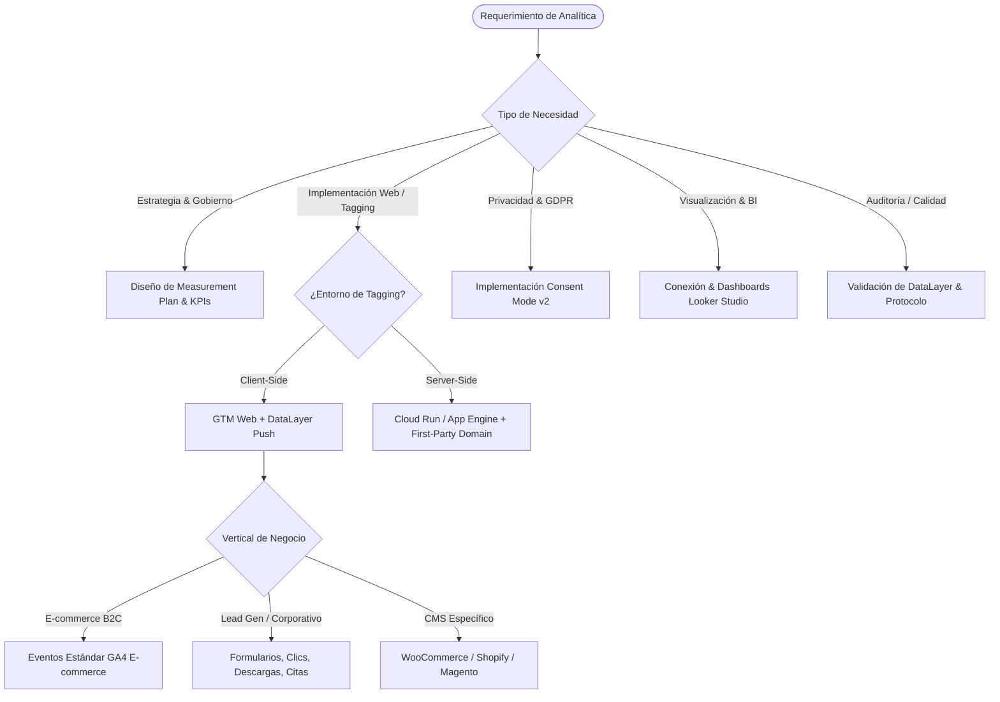

# Digital Analytics: GA4 & Google Tag Manager (Client & Server-Side)

## Propósito y Alcance Operativo
Esta skill otorga al agente la capacidad de diseñar, auditar, implementar y optimizar ecosistemas completos de analítica digital. Cubre desde la definición estratégica de KPIs y planes de medición (Measurement Plan), pasando por la instrumentación técnica de eventos y capas de datos (DataLayer) en Google Tag Manager, el cumplimiento estricto de privacidad con **Consent Mode v2**, arquitecturas avanzadas **GTM Server-Side**, hasta la integración con **Looker Studio** para reporting directivo.

---

## 1. Árbol de Decisión Operativo

---

## 2. Flujo de Trabajo Metodológico (Paso a Paso)

### Fase 1: Diagnóstico y Measurement Plan (Plan de Medición)
1. **Identificación de Objetivos de Negocio:**
   - E-commerce: Incrementar tasa de conversión (CR), valor medio del pedido (AOV), reducir abandono de checkout.
   - Lead Generation: Reducir costo por adquisición (CPA), aumentar tasa de formularios completados, cualificar prospectos (MQL).
2. **Definición de Arquitectura de Eventos:**
   - **Eventos recogidos automáticamente:** `page_view`, `first_visit`, `session_start`.
   - **Medición mejorada (Enhanced Measurement):** `scroll`, `click` (salientes), `view_search_results`, `video_*`, `file_download`, `form_submit`.
   - **Eventos recomendados (E-commerce / Negocio):** `view_item_list`, `select_item`, `view_item`, `add_to_cart`, `remove_from_cart`, `view_cart`, `begin_checkout`, `add_shipping_info`, `add_payment_info`, `purchase`, `generate_lead`.
   - **Eventos personalizados (Custom):** Reservados únicamente cuando no exista un evento recomendado equivalente en la taxonomía oficial de GA4.
3. **Mapeo de Dimensiones y Métricas por Alcance (Scope):**
   - *Alcance Evento:* Parámetros que cambian con cada interacción puntual (`transaction_id`, `payment_type`, `shipping_tier`).
   - *Alcance Usuario:* Atributos persistentes del cliente (`user_id`, `customer_segment`, `loyalty_tier`, `lifetime_purchases`).
   - *Alcance Ítem:* Propiedades específicas de cada producto en un array `items` (`item_id`, `item_name`, `item_category`, `price`, `discount`).
   - *Alcance Sesión:* Métricas calculadas o dimensiones como `session_source_medium`.

---

### Fase 2: Configuración de GA4 y Gobernanza
1. **Flujos de Datos (Data Streams):**
   - Crear el flujo Web correspondiente y extraer el identificador `Measurement ID` (`G-XXXXXXXXXX`).
2. **Retención de Datos:**
   - Cambiar inmediatamente la retención de eventos en la interfaz de Administrador de **2 meses** a **14 meses** (máximo permitido para cuentas gratuitas de GA4).
3. **Parámetros UTM y Atribución:**
   - Garantizar la taxonomía de campañas: `utm_source`, `utm_medium`, `utm_campaign`, `utm_content`, `utm_term`.
   - Comprender los modelos de atribución (Basado en datos / Data-driven por defecto en GA4 vs Último clic / Last-click).

---

### Fase 3: Instrumentación en Google Tag Manager (Client-Side)
1. **Regla de Oro del DataLayer:**
   - El DataLayer debe ser empujado usando `window.dataLayer = window.dataLayer || []; window.dataLayer.push({ ... });`.
   - Para eventos de E-commerce, limpiar previamente el objeto ecommerce con `ecommerce: null` para evitar polución de arrays o mezclas de items en navegadores SPA (Single Page Applications).
2. **Configuración de Variables en GTM:**
   - Variables de Capa de Datos (Data Layer Variables) para extraer datos anidados: `ecommerce.currency`, `ecommerce.value`, `ecommerce.transaction_id`, `ecommerce.items`.
   - Variables de Custom JavaScript (CJS) para transformaciones de formato, parseos numéricos o normalización de strings.
3. **Etiquetas y Activadores (Tags & Triggers):**
   - **Etiqueta de Configuración / Google Tag:** Disparador en `Initialization - All Pages` o `Consent Initialization - All Pages`.
   - **Etiquetas de Evento GA4:** Disparadores tipo *Custom Event* vinculados exactamente al nombre del evento empujado en el dataLayer (`purchase`, `add_to_cart`, etc.).
   - Parámetro de envío `send_ecommerce_data: true` o mapeo explícito de parámetros del evento.
4. **Integración de Plataformas de Publicidad:**
   - **Píxel de Meta (Facebook Ads):** Inyección de script base vía Custom HTML tag o Community Template con disparador `Page View`. Eventos estándar (`ViewContent`, `AddToCart`, `InitiateCheckout`, `Purchase`) sincronizados con el dataLayer de GA4.
   - **Conversiones de Google Ads:** Etiqueta Vinculadora de Conversiones (Conversion Linker) en todas las páginas + Etiqueta de Conversión de Google Ads con `Conversion ID` y `Conversion Label`.

---

### Fase 4: Privacidad y Consent Mode v2
1. **Marco Regulatorio:** Obligatorio en el Espacio Económico Europeo (EEA/GDPR) para la recolección de audiencias y modelado de conversiones.
2. **Cuatro Parámetros de Consentimiento:**
   - `ad_storage`: Almacenamiento con fines publicitarios.
   - `analytics_storage`: Almacenamiento analítico / cookies.
   - `ad_user_data`: Envío de datos del usuario a Google para publicidad (v2).
   - `ad_personalization`: Personalización de anuncios y remarketing (v2).
3. **Modos de Consentimiento:**
   - **Modo Avanzado (Advanced Consent Mode):** Las etiquetas de Google se ejecutan antes del consentimiento con pings anónimos ("cookieless pings"). Permite modelado predictivo mediante Machine Learning en GA4.
   - **Modo Básico (Basic Consent Mode):** Bloqueo total de la ejecución de tags hasta que el usuario acepte explícitamente en el CMP. No hay modelado de cookieless pings.
4. **Integración con CMPs (Cookiebot, Iubenda, OneTrust):**
   - Disparo en `Consent Initialization - All Pages` para registrar el estado default (`denied` por defecto en las 4 señales).

---

### Fase 5: Medición en el Servidor (GTM Server-Side)
1. **Beneficios Clave:**
   - Mitigación de bloqueadores de anuncios (ad-blockers).
   - Mitigación de restricciones de Safari/WebKit (ITP - Intelligent Tracking Prevention) al operar bajo dominio First-Party (`data.midominio.com`).
   - Reducción del peso de scripts de terceros en el navegador del cliente (mejora de Core Web Vitals).
   - Gobierno estricto de datos: anonimización y filtrado de PII (Personally Identifiable Information) antes de enviar a proveedores externos.
2. **Infraestructura:**
   - Despliegue en Google Cloud Platform (Cloud Run o App Engine) con configuración multirregión / escalabilidad automática.
   - Mapeo de DNS (registro tipo CNAME o A para el subdominio de recolección).
3. **Ruta de Despacho:**
   - El cliente Web envía el payload al Endpoint del Servidor (Client GA4 en GTM SS).
   - La etiqueta del servidor reenvía el hit procesado a los servidores oficiales de Google Analytics 4 mediante el protocolo seguro.

---

### Fase 6: Explotación y Visualización en Looker Studio
1. **Conector Nativo de GA4:**
   - Conexión directa seleccionando la cuenta y propiedad correspondiente.
2. **Estructura de Dashboards Ejecutivos:**
   - **Página 1: Resumen Ejecutivo (Executive Summary):** Sesiones, Usuarios activos, Tasa de conversión, Ingresos totales, Tarjetas KPI con variación interanual / vs periodo anterior.
   - **Página 2: Rendimiento de Adquisición:** Canales principales (Default Channel Grouping), Rendimiento de campañas UTM, Costo vs Retorno.
   - **Página 3: Funnel de Conversión (Embudo E-commerce):** Gráfico de barras de etapas (Vistas de producto -> Carritos -> Inicio Checkout -> Transacción).
   - **Página 4: Comportamiento y Contenido:** Páginas más visitadas, eventos más frecuentes, análisis geográfico y tecnológico (dispositivos).
3. **Estándares Visuales:**
   - Aplicación de principios Gestalt (proximidad, contraste y orden jerárquico).
   - Filtros globales de fecha, país y canal en la cabecera fija.

---

## 3. Antipatrones Críticos a Evitar

| Antipatrón | Consecuencia | Corrección Mandatoria |
| :--- | :--- | :--- |
| **No reiniciar el objeto `ecommerce` a `null`** | Datos residuales del evento anterior contaminan la siguiente interacción en SPAs. | Ejecutar `dataLayer.push({ ecommerce: null });` inmediatamente antes de cada push de e-commerce. |
| **Disparar tags en `All Pages` sin control de consentimiento** | Multas GDPR graves y fallas en Consent Mode v2. | Configurar el CMP y disparadores basados en `Consent Initialization` o respetar el tag consent settings nativo. |
| **Usar nombres de eventos con mayúsculas o espacios** (`Add to Cart`) | GA4 trata los eventos como personalizados, perdiendo informes nativos de e-commerce. | Usar estrictamente `snake_case` oficial (`add_to_cart`). |
| **Enviar precios con símbolos de moneda** (`price: "$19.99"`) | GA4 no puede sumarizar o calcular métricas de ingresos (Revenue). | Enviar `price` como número float o integer (`price: 19.99`). |
| **Mantener retención en 2 meses** | Pérdida de histórico de exploraciones a los 60 días. | Cambiar la configuración de retención de la propiedad a 14 meses el día 1. |

---

## 4. Checklist de Verificación y Testing

1. **Tag Assistant & Preview Mode:**
   - Abrir el modo de vista previa de GTM (`tagassistant.google.com`).
   - Validar que cada evento del dataLayer genera el disparo de su tag GA4 correspondiente.
2. **GA4 DebugView:**
   - Verificar en tiempo real la llegada del evento y la presencia de todos sus parámetros y el array `items`.
3. **Network Tab (Consola del Navegador):**
   - Filtrar por `/collect?v=2`.
   - Inspeccionar parámetros clave: `tid` (Measurement ID), `en` (Event Name), `gcs` (Google Consent Status), `gcd` (Google Consent Declaration).
4. **Validación de Consent Mode:**
   - Inspeccionar el parámetro `gcs`: ej. `G100` (denegado), `G111` (aceptado), asegurando que la señal cambie según la interacción con el banner de cookies.

