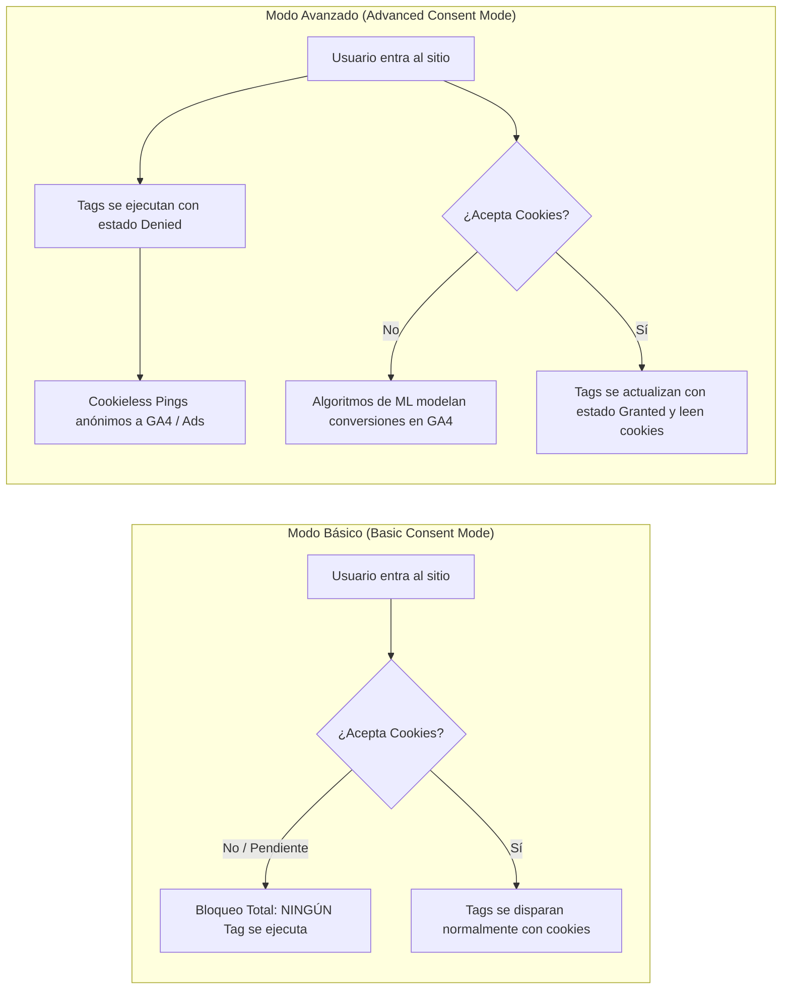

# Guía de Implementación Técnica de Consent Mode v2

Google Consent Mode v2 es el marco obligatorio exigido por Google en el Espacio Económico Europeo (EEA) bajo las directrices del Reglamento General de Protección de Datos (GDPR) y la Digital Markets Act (DMA). Su implementación es indispensable para conservar la medición de audiencias de remarketing y el modelado de conversiones en Google Ads y GA4.

---

## 1. Los 4 Parámetros Clave de Consentimiento

| Parámetro | Versión | Propósito Operativo |
| :--- | :--- | :--- |
| `analytics_storage` | v1 | Permite el almacenamiento de cookies o identificadores con propósitos estadísticos y analíticos (GA4). |
| `ad_storage` | v1 | Permite el almacenamiento de cookies con propósitos publicitarios (Google Ads, Remarketing). |
| `ad_user_data` | **v2 (Nuevo)** | Determina si se otorga consentimiento para enviar datos personales del usuario (ej. email hasheado en conversiones mejoradas) a Google para publicidad. |
| `ad_personalization` | **v2 (Nuevo)** | Determina si los datos del usuario pueden ser utilizados para remarketing y personalización de anuncios en las redes de Google. |

---

## 2. Modo Básico vs Modo Avanzado (Basic vs Advanced)



- **Modo Básico:** Máxima cautela legal, pero genera una pérdida de visibilidad de entre 30% y 60% del tráfico total. No se envían señales hasta la aceptación expresa.
- **Modo Avanzado:** Recomendado por Google. Envía pings sin cookies cuando el estado es `denied`. Los identificadores `client_id` no persisten, permitiendo a los modelos de Machine Learning de GA4 recuperar el volumen de conversiones y sesiones no consentidas mediante modelado estadístico.

---

## 3. Implementación Estándar en GTM

### Paso 1: Configuración del Estado por Defecto (Default State)
Debe ejecutarse antes de cualquier otra etiqueta, idealmente en la cabecera HTML o en un Custom HTML disparado en el evento `Consent Initialization - All Pages`:

```html
<script>
  window.dataLayer = window.dataLayer || [];
  function gtag(){dataLayer.push(arguments);}

  // Estado predeterminado DENEGADO para las 4 señales en usuarios del EEA
  gtag('consent', 'default', {
    'ad_storage': 'denied',
    'analytics_storage': 'denied',
    'ad_user_data': 'denied',
    'ad_personalization': 'denied',
    'wait_for_update': 500 // Tiempo en ms de espera para que el CMP cargue
  });
</script>
```

### Paso 2: Actualización tras la Interacción con el Banner (Update)
Cuando el usuario acepta las cookies en el CMP (ej. Cookiebot, OneTrust, Iubenda), el banner ejecuta la actualización:

```javascript
gtag('consent', 'update', {
  'ad_storage': 'granted',
  'analytics_storage': 'granted',
  'ad_user_data': 'granted',
  'ad_personalization': 'granted'
});
```

---

## 4. Diagnóstico e Inspección Técnica en Red (Network)

Al inspeccionar las solicitudes HTTP salientes a Google Analytics (`/collect?v=2`), se deben validar dos parámetros clave:

### Parámetro `gcs` (Google Consent Status)
Cadena de tres caracteres que codifica el estado de consentimiento: `G1` + `[ad_storage]` + `[analytics_storage]`.
- `0` = Denegado
- `1` = Concedido

Ejemplos:
- `gcs=G100`: Ambos denegados (Ad=Denied, Analytics=Denied).
- `gcs=G110`: Ad concedido, Analytics denegado.
- `gcs=G101`: Ad denegado, Analytics concedido.
- `gcs=G111`: Ambos concedidos (Ad=Granted, Analytics=Granted).

### Parámetro `gcd` (Google Consent Declaration)
Codifica en formato extendido el estado de las 4 señales tanto por defecto como tras la actualización (ejemplo: `gcd=13t3t3t2t5`). Los caracteres alfanuméricos indican si la señal fue explícita o por defecto.

