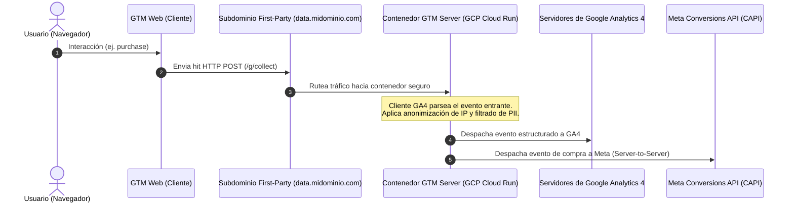

# Guía de Arquitectura e Implementación: GTM Server-Side

La medición desde el servidor (Server-Side Tagging) traslada el procesamiento y despacho de eventos desde el navegador del usuario hacia un contenedor de servidor privado alojado en la nube.

---

## 1. Arquitectura de Flujo de Datos

---

## 2. Ventajas Competitivas y de Rendimiento

1. **Contexto First-Party Total:**
   - Al configurar el contenedor de servidor bajo un subdominio propio (ej. `sgtm.empresa.com` mediante DNS con registro A / CNAME), las cookies creadas desde la respuesta HTTP del servidor adquieren el atributo `HttpOnly` y `Secure`, mitigando las restricciones de expiración a 1 o 7 días impuestas por Apple ITP (Intelligent Tracking Prevention en Safari/iOS).
2. **Resiliencia ante Ad-Blockers:**
   - Las solicitudes no se dirigen a dominios conocidos de rastreo (`google-analytics.com`), sino al dominio de la propia empresa.
3. **Optimización de Core Web Vitals:**
   - En lugar de ejecutar múltiples librerías pesadas en el navegador del usuario (GA4, Facebook Pixel, TikTok Pixel, LinkedIn Insight Tag), se carga un único flujo ligero hacia el servidor, y el servidor se encarga de retransmitir los datos a cada plataforma.
4. **Gobierno y Seguridad de Datos:**
   - Control total sobre qué datos viajan a terceros. Se puede eliminar información sensible (PII como direcciones IP, correos electrónicos en texto plano o query params con tokens de autenticación) antes de que abandonen el entorno corporativo.

---

## 3. Guía de Despliegue en Google Cloud Platform (Cloud Run)

### Paso 1: Creación del Contenedor en GTM
1. En GTM (`tagmanager.google.com`), crear un nuevo contenedor y seleccionar la opción **Servidor (Server)**.
2. Seleccionar "Aprovisionar manualmente el servidor de etiquetado" para obtener la clave de configuración del contenedor (`CONTAINER_CONFIG`).

### Paso 2: Despliegue en Google Cloud Run
El contenedor de servidor de GTM se distribuye como una imagen Docker oficial mantenida por Google:
`gcr.io/cloud-tagging-102307/gtm-cloud-image:latest`

Variables de entorno requeridas en Cloud Run:
- `CONTAINER_CONFIG`: El string alfanumérico proporcionado por GTM.
- `PORT`: `8080` (estándar en Cloud Run).
- `RUN_AS_PREVIEW_SERVER`: `true` (en configuraciones de servidor único / testing).

### Paso 3: Mapeo de Dominio Personalizado
1. En Cloud Native DNS o en tu proveedor de hosting (Cloudflare, GoDaddy, Route53), agregar un registro DNS:
   - Tipo: `CNAME`
   - Nombre / Host: `data` (o `sgtm`)
   - Destino: La URL provista por Google Cloud Run.
2. Validar el certificado SSL automático provisto por GCP.

### Paso 4: Ajuste del Contenedor Web (Client-Side)
En el contenedor Web de GTM, actualizar la Etiqueta de Google (Google Tag):
- Parámetro de configuración: `server_container_url`
- Valor: `https://data.midominio.com`

A partir de este cambio, todos los eventos del navegador se enviarán al endpoint del servidor.

