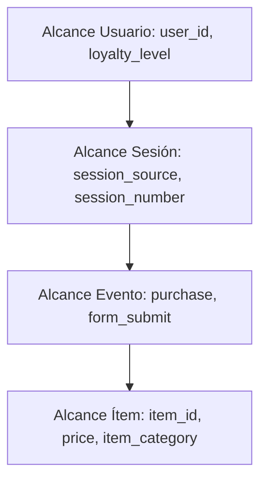

# Framework y Plantilla de Measurement Plan (Plan de Medición)

Un Plan de Medición corporativo es el puente entre los objetivos estratégicos de la directiva y la implementación técnica de etiquetado en GA4 y GTM.

---

## 1. Matriz de Jerarquía de Medición

| Nivel | Definición | Ejemplo E-commerce | Ejemplo B2B / Lead Gen |
| :--- | :--- | :--- | :--- |
| **Objetivo de Negocio** | Meta de alto nivel de la empresa. | Incrementar ingresos netos y fidelización. | Generar prospectos comerciales calificados. |
| **Estrategia Digital** | Cómo la web/app ayuda a lograr el objetivo. | Facilitar compra fluida y cross-selling. | Ofrecer cotizaciones y demos personalizadas. |
| **KPI (Key Performance Indicator)** | Métrica cuantitativa de éxito. | Ingresos totales, Tasa de Conversión (CR), AOV. | Total Leads (MQL), Costo por Lead (CPL). |
| **Target / Meta** | Valor numérico a alcanzar en el período. | CR > 2.8%, AOV > $85. | 500 MQLs/mes, CPA < $45. |
| **Segmento de Análisis** | Dimensiones para filtrar e interpretar. | País, Dispositivo, Canal de Adquisición. | Industria, Tamaño de Empresa, Fuente UTM. |
| **Evento Técnico** | Disparo en el dataLayer / GA4. | `purchase`, `add_to_cart`. | `generate_lead`, `file_download`. |

---

## 2. Taxonomía de Eventos GA4 por Tipo

### A. Eventos Recogidos Automáticamente
Se activan sin necesidad de configuración adicional al inicializar el SDK o Tag de GA4:
- `page_view`: Carga de nueva página (o cambio de ruta en SPAs si está activado).
- `first_visit`: Primera interacción de un usuario nuevo.
- `session_start`: Nueva sesión (inactividad superior a 30 min por defecto).
- `user_engagement`: Tiempo de interacción activa del usuario.

### B. Medición Mejorada (Enhanced Measurement)
Se configuran desde la interfaz del Data Stream en GA4:
- `scroll`: Activado por defecto al 90% de profundidad de página.
- `click`: Clics en enlaces salientes que apuntan fuera del dominio actual.
- `view_search_results`: Búsquedas en el buscador interno de la web (`q`, `s`, `search`, etc.).
- `video_start`, `video_progress`, `video_complete`: Interacciones con videos de YouTube embebidos con JS API.
- `file_download`: Clics en extensiones comunes de archivos (`pdf`, `xlsx`, `docx`, `zip`).
- `form_start`, `form_submit`: Detección nativa de interacción con elementos `<form>`.

### C. Eventos Recomendados (Taxonomía Estándar Google)
Deben ser implementados respetando estrictamente los nombres y parámetros oficiales para habilitar los informes estándar de GA4:
- **E-commerce B2C / Retail:**
  - `view_item_list` (Lista de productos o catálogo)
  - `select_item` (Clic en un producto de la lista)
  - `view_item` (Ficha detallada del producto)
  - `add_to_cart` (Agregar al carrito)
  - `remove_from_cart` (Eliminar del carrito)
  - `view_cart` (Ver página de carrito)
  - `begin_checkout` (Inicio del proceso de pago)
  - `add_shipping_info` (Selección de método de envío)
  - `add_payment_info` (Selección de método de pago)
  - `purchase` (Transacción exitosa completada)
  - `refund` (Reembolso total o parcial)
- **Generación de Oportunidades y Servicios:**
  - `generate_lead` (Envío de formulario o contacto comercial)
  - `sign_up` (Registro de nuevo usuario)
  - `login` (Inicio de sesión)

### D. Eventos Personalizados (Custom Events)
- Reservados para acciones únicas de negocio (ej. `calculator_used`, `tool_step_complete`, `request_sample`).
- Requieren registro manual de Dimensiones y Métricas personalizadas en la interfaz de Administrador de GA4 para ser explotadas en Exploraciones.

---

## 3. Matriz de Alcances (Scopes) en GA4

- **Scope Usuario:** Atributo fijo del perfil que trasciende sesiones.
- **Scope Sesión:** Contexto que agrupa los eventos de una visita (ej. canal de entrada).
- **Scope Evento:** Datos propios de la acción instantánea.
- **Scope Ítem:** Propiedades individuales de los elementos dentro del array `items`.

