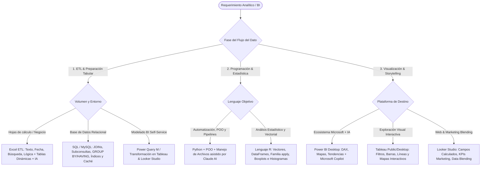

# Experto en Análisis y Visualización de Datos + IA (Multi-Tool 7-Stack & AI)

## Propósito y Alcance Operativo
Esta skill capacita al agente para diseñar, ejecutar y auditar flujos de trabajo analíticos de extremo a extremo (*End-to-End Data Lifecycle*) combinando las **7 herramientas líderes del mercado** (**Excel, SQL/MySQL, Python, R, Looker Studio, Power BI y Tableau**) junto con **Inteligencia Artificial Generativa aplicada** (**Microsoft Copilot para Power BI/DAX**, **Claude AI para desarrollo y depuración en Python**, y **Analizar Datos con IA en Excel**).

Fundamentada en la certificación oficial **Experto en Análisis y Visualización de Datos + IA** (*DataBoosters Academy — Jorge Alberto Chávez Sarmiento, Juan Carlos Hernández Ramírez, Luis Alberto Reyes, Flavio César Sandoval Muñoz; 47 horas totales, 387 clases, 62 secciones*).

---

## 1. Árbol de Decisión Multi-Herramienta

---

## 2. Metodología Operativa por Herramienta (Las 7 Herramientas + IA)

### Pilar 1: Proceso ETL Completo y Excel Analítico con IA Integrada
1. **Limpieza y Transformación Pre-Visualización (ETL):**
   - **Funciones de Texto:** Normalización de mayúsculas/minúsculas (`PROPER`/`NOMPROPIO`, `UPPER`, `LOWER`), limpieza de espacios (`TRIM`/`ESPACIOS`), extracción y concatenación (`LEFT`, `RIGHT`, `MID`, `TEXTJOIN`, `SPLIT`).
   - **Funciones de Fecha:** Extracción de componentes temporales (`YEAR`, `MONTH`, `DAY`, `WEEKDAY`, `DATEDIF`, `EOMONTH`) para análisis estacional y cohortes.
   - **Funciones de Búsqueda y Referencia:** Cruce de catálogos con `XLOOKUP` (`BUSCARX`), `VLOOKUP` (`BUSCARV`) e `INDEX/MATCH` (`INDICE/COINCIDIR`).
   - **Funciones Lógicas y Condicionales:** Reglas de negocio anidadas con `IF`, `IFS`, `AND`, `OR`, `IFERROR` y agregaciones condicionales (`SUMIFS`, `COUNTIFS`, `AVERAGEIFS`).
2. **Dashboards en Excel e IA Integrada:**
   - Construcción de **Tablas Dinámicas** vinculadas mediante **Segmentadores de datos (Slicers)** y **Escalas de tiempo (Timelines)**.
   - Uso de la herramienta **"Analizar datos" (Analyze Data / Ideas con IA)** en Excel para detección rápida de tendencias, outliers y generación de tablas resumen mediante consultas en lenguaje natural.

### Pilar 2: Consultas SQL / MySQL y Optimización de Rendimiento
1. **Arquitectura de Consultas Analíticas:**
   - Selección y filtrado preciso (`SELECT`, `DISTINCT`, `WHERE`, operadores lógicos y de rango `BETWEEN`, `IN`, `LIKE`).
   - Combinación relacional multi-tabla (`INNER JOIN`, `LEFT JOIN`, `RIGHT JOIN`, `CROSS JOIN`) verificando cardinalidad para evitar duplicación de métricas.
   - Agregación avanzada con `GROUP BY` y filtrado post-agregación con `HAVING`.
   - **Subconsultas** escalares, de tabla derivada y correlacionadas (`IN`, `EXISTS`) para comparaciones contra promedios globales o umbrales dinámicos.
2. **Optimización de Rendimiento SQL (Índices y Caché):**
   - Creación estratégica de **Índices (`CREATE INDEX`)** sobre claves foráneas, columnas de `JOIN`, predicados `WHERE` frecuentes y columnas de ordenamiento (`ORDER BY`).
   - Uso de `EXPLAIN` / `EXPLAIN ANALYZE` para evitar *Full Table Scans* innecesarios.
   - Aprovechamiento de caché de resultados y predicados *SARGable* (evitar aplicar funciones sobre columnas indexadas en el `WHERE`, ej. usar rangos de fecha en vez de `YEAR(fecha) = 2026`).

### Pilar 3: Programación en Python (POO) + Asistencia con Claude AI
1. **Desarrollo en Python aplicado a Datos:**
   - Tipos de datos, colecciones (`list`, `tuple`, `dict`, `set`), estructuras de control y funciones modulares.
   - **Programación Orientada a Objetos (POO)** aplicada a flujos de datos: diseño de clases (`class`), constructores (`__init__`), encapsulamiento de lógica de validación, métodos de transformación y herencia para conectores o procesadores de datos reutilizables.
   - **Manejo de Archivos (`File I/O`):** Lectura, procesamiento por lotes y escritura segura con administradores de contexto (`with open(...)`) para archivos CSV, JSON, TXT y logs de auditoría.
2. **Flujo de Trabajo con Claude AI como Copiloto de Python:**
   - **Estructuración de Prompts Técnicos:** Especificar siempre esquema de entrada, tipos de datos, restricciones de memoria y resultado esperado.
   - **Depuración Asistida (Debugging):** Uso de Claude para interpretar *tracebacks*, corregir errores de tipos o bordes (*edge cases*), refactorizar bucles lentos a operaciones vectorizadas y generar pruebas unitarias.

### Pilar 4: Análisis Estadístico y Exploratorio con Lenguaje R
1. **Estructuras Base y Manipulación Vectorial:**
   - Trabajo con **Vectores** tipados (`c()`, secuencias, indexación lógica), **Factores** para variables categóricas ordinales/nominales, **Listas** y **DataFrames** (`data.frame`).
2. **Programación Funcional con la Familia `apply`:**
   - Reemplazo de bucles explícitos por funciones vectorizadas de alto rendimiento:
     - `apply(X, MARGIN, FUN)`: Operaciones por filas (`1`) o columnas (`2`) en matrices/dataframes numéricos.
     - `lapply(X, FUN)` y `sapply(X, FUN)`: Transformación sobre listas o columnas devolviendo listas o vectores simplificados.
     - `tapply(X, INDEX, FUN)`: Agregaciones estadísticas agrupadas por factores o categorías (equivalente funcional a `GROUP BY`).
3. **Visualización Estadística y EDA en R:**
   - Gráficos personalizados para diagnóstico de distribuciones: **Histogramas (`hist()`)** para simetría y sesgo, **Diagramas de Caja (`boxplot()`)** para rango intercuartílico (IQR) y detección de valores atípicos (*outliers*), y gráficos de dispersión/barras con parámetros gráficos personalizados (`col`, `main`, `xlab`, `ylab`, `par(mfrow=...)`).

### Pilar 5: Looker Studio (Data Studio) y Data Blending de Marketing
1. **Combinación de Fuentes (`Data Blending`):**
   - Unión de hasta 5 fuentes heterogéneas (ej. Google Analytics 4 + Google Ads + Meta Ads + Google Sheets/BigQuery) configurando claves de unión (*Join Keys*) temporales y dimensionales sin duplicar presupuestos ni sesiones.
2. **Campos Calculados y KPIs de Marketing/Negocio:**
   - Fórmulas con `CASE WHEN ... THEN ... ELSE ... END`, métricas de eficiencia publicitaria y comercial (**ROAS**, **CPA**, **CTR**, **CPC**, **Tasa de Conversión**, **LTV/CAC**) y publicación web embebida.

### Pilar 6: Power BI Avanzado + Microsoft Copilot (IA para DAX y Reportes)
1. **Modelado, Power Query, DAX y Analítica Visual:**
   - Transformación ETL en **Power Query**, diseño de modelo estrella, medidas **DAX** (`CALCULATE`, `FILTER`, inteligencia de tiempo, iteradores `SUMX`/`AVERAGEX`).
   - Visualizaciones avanzadas: **Mapas geográficos** (coropléticos y de burbujas) y panel **Analítico** con **líneas de tendencia**, líneas de promedio/mediana y pronósticos (*forecasting*).
2. **Microsoft Copilot en Power BI:**
   - **Generación de Medidas DAX con Lenguaje Natural:** Ingeniería de prompts sobre el modelo semántico indicando tabla, columna, filtros de negocio y manejo de blancos.
   - **Creación Automática de Páginas e Insights:** Solicitud a Copilot de páginas de resumen ejecutivo, explicación de variaciones en gráficos y generación de narrativas inteligentes (*Smart Narratives*).

### Pilar 7: Tableau (Transformación y Dashboards Interactivos)
1. **Preparación e Importación en Tableau:**
   - Conexión a fuentes de datos, clasificación de campos en **Dimensiones** (discretas/azules) vs **Medidas** (continuas/verdes), división de columnas (*Split*), pivotado y campos calculados.
2. **Construcción de Vistas y Lienzos Interactivos:**
   - Creación de gráficos de barras comparativos, series temporales con líneas de tendencia y **Mapas Geográficos Interactivos** mediante roles geográficos (*Country, State, City, Lat/Long*).
   - Aplicación de filtros de contexto, filtros interactivos para el usuario final y acciones de filtro cruzado (*Filter Actions*) en el dashboard.

---

## 3. Antipatrones Críticos a Evitar (Reglas de Control)

- ❌ **Usar código o medidas DAX generadas por IA (Claude / Copilot) sin auditar totales:** Toda medida DAX generada por Microsoft Copilot o script Python generado por Claude debe validarse contra un total de control conocido antes de pasar a producción.
- ❌ **Hacer consultas SQL sin índices en columnas de `JOIN` o con funciones no-SARGable en `WHERE`:** Nunca filtrar como `WHERE DATE_FORMAT(fecha, '%Y') = '2026'` si la columna `fecha` está indexada; usar `WHERE fecha >= '2026-01-01' AND fecha < '2027-01-01'`.
- ❌ **Usar bucles `for` fila por fila en R o Python para agregaciones tabulares:** En R utilizar siempre la familia `apply` (`apply`, `lapply`, `sapply`, `tapply`) o vectorización nativa.
- ❌ **Mezclar granularidades en el Data Blending de Looker Studio:** Nunca unir directamente una tabla a nivel diario con una tabla a nivel mensual sin antes alinear la clave temporal de unión.

---

## 4. Referencias Técnicas, Scripts y Ejemplos de esta Skill

- **Referencias (`references/`):**
  - [multi_tool_etl_sql_optimization.md](./references/multi_tool_etl_sql_optimization.md): Guía de ETL (Excel/Power Query/Tableau) y optimización SQL con índices y caché.
  - [r_analytics_and_apply_guide.md](./references/r_analytics_and_apply_guide.md): Guía práctica de Lenguaje R (Vectores, DataFrames, familia `apply`, Histogramas y Boxplots).
  - [ai_copilot_dax_and_claude_python.md](./references/ai_copilot_dax_and_claude_python.md): Playbook de Ingeniería de Prompts para Microsoft Copilot en Power BI (DAX) y Claude AI para Python POO.
  - [tableau_looker_pbi_viz_matrix.md](./references/tableau_looker_pbi_viz_matrix.md): Matriz comparativa de implementación visual entre Tableau, Power BI y Looker Studio (Data Blending, Mapas y Tendencias).
- **Scripts Ejecutables (`scripts/`):**
  - [oop_etl_pipeline.py](./scripts/oop_etl_pipeline.py): Pipeline ETL modular en Python construido con Programación Orientada a Objetos (POO) y auditoría de calidad.
  - [r_eda_apply_analysis.R](./scripts/r_eda_apply_analysis.R): Script estadístico en R utilizando vectores, dataframes, `lapply`/`sapply`/`tapply`, histogramas y boxplots.
- **Ejemplos (`examples/`):**
  - [sql_indexing_and_query_optimization.sql](./examples/sql_indexing_and_query_optimization.sql): Caso completo de consultas SQL analíticas (`JOIN`, subconsultas, `GROUP BY`/`HAVING`) y optimización con índices compuestos.
  - [copilot_dax_and_claude_prompts.md](./examples/copilot_dax_and_claude_prompts.md): Plantillas reales de prompts y medidas DAX generadas/validadas con Copilot y Claude AI.
