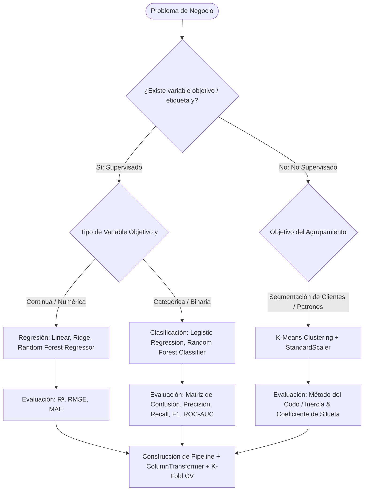

# Machine Learning for Business Analytics: Predictive Modeling & Unsupervised Segmentation

## Propósito y Alcance Operativo
Esta skill capacita al agente para formular, desarrollar, validar y desplegar modelos de Machine Learning aplicados a problemas de negocio utilizando **Scikit-Learn**. Cubre el ciclo de vida completo de la ciencia de datos: formulación analítica de la hipótesis, preprocesamiento y feature engineering con `ColumnTransformer`, construcción de `Pipelines` robustos para erradicar el **Data Leakage**, modelos predictivos supervisados (Regresión Lineal, Regresión Logística, Árboles de Decisión, Random Forest), segmentación no supervisada (**K-Means** con Silhouette Score y Método del Codo), optimización con `GridSearchCV`/`RandomizedSearchCV`, y traducción de métricas matemáticas en valor económico.

---

## 1. Árbol de Decisión Operativo

---

## 2. Flujo de Trabajo Metodológico (Paso a Paso)

### Fase 1: Formulación del Problema y Mapeo al Negocio
1. **Definición de la Variable Objetivo ($y$):**
   - Regresión: Predecir volumen de ventas futuras, precio óptimo de un producto, valor de vida del cliente (LTV).
   - Clasificación: Predecir abandono de clientes (Churn: 1=Abandona, 0=Permanece), fraude en transacciones o mora crediticia.
   - No Supervisado: Agrupar clientes por patrones de consumo sin etiquetas previas (RFM: Recencia, Frecuencia, Monto).
2. **Definición de la Métrica de Negocio Prioritaria:**
   - En Churn o Detección de Fraude: Minimizar los Falsos Negativos es crítico $\rightarrow$ Optimizar el **Recall**.
   - En Campañas de Marketing con presupuesto acotado: Minimizar Falsos Positivos $\rightarrow$ Optimizar la **Precision**.

---

### Fase 2: División de Datos y Regla Absoluta Anti-Data Leakage
1. **División Inicial (Train / Test Split):**
   - La partición de datos (`train_test_split`) debe realizarse **antes de cualquier cálculo estadístico** (medias, desviaciones, percentiles o imputaciones).
   - En clasificación con clases desbalanceadas: Usar obligatoriamente `stratify=y`.
2. **La Regla de Oro del Preprocesamiento:**
   - **`fit()` o `fit_transform()`:** Se ejecuta **ÚNICAMENTE** sobre el conjunto de entrenamiento (`X_train`).
   - **`transform()`:** Se aplica sobre el conjunto de prueba (`X_test`) y nuevos datos en inferencia.
   - **PROHIBIDO:** Aplicar escaladores (`StandardScaler`) o imputadores sobre el dataset completo antes del split (Data Leakage severo).

---

### Fase 3: Preprocesamiento y Feature Engineering con `ColumnTransformer`
1. **Ramas de Transformación Desacopladas:**
   - **Variables Numéricas:**
     - Imputación con `SimpleImputer(strategy='median')`.
     - Escalado con `StandardScaler()` (para modelos sensibles a distancias: Logistic Regression, K-Means) o `MinMaxScaler()`.
   - **Variables Categóricas:**
     - Imputación con `SimpleImputer(strategy='most_frequent')`.
     - Codificación con `OneHotEncoder(handle_unknown='ignore', sparse_output=False)` para evitar errores con nuevas categorías en producción.

---

### Fase 4: Modelado Supervisado y Ensambles
1. **Modelos Lineales:**
   - `LinearRegression`: Línea base (*baseline*) interpretable para variables continuas.
   - `LogisticRegression`: Modelo probabilístico calibrado para clasificación binaria/multiclase.
2. **Modelos Basados en Árboles y Ensambles:**
   - `DecisionTreeClassifier` / `DecisionTreeRegressor`: Captura no linealidades; útil para árboles de decisión explicables a stakeholders.
   - `RandomForestClassifier` / `RandomForestRegressor`: Ensamble por bagging de múltiples árboles; reduce el sobreajuste (*overfitting*) y otorga alta capacidad predictiva sin requerir escalado estricto de variables.

---

### Fase 5: Segmentación No Supervisada con K-Means
1. **Normalización Obligatoria:**
   - K-Means calcula distancias euclidianas. Si una variable está en escala de miles (ingresos) y otra en decenas (edad), la variable de ingresos distorsionará el agrupamiento. El uso de `StandardScaler` es mandatorio.
2. **Selección del Número Óptimo de Clústeres ($k$):**
   - **Método del Codo (Elbow Method):** Graficar la inercia (suma de distancias al cuadrado dentro de cada clúster) para diferentes valores de $k$ e identificar el punto de inflexión.
   - **Coeficiente de Silueta (Silhouette Score):** Evalúa qué tan compacto está cada clúster y qué tan separado está de los demás (rango de -1 a 1). Seleccionar el $k$ que maximice la silueta media.

---

### Fase 6: Validación Cruzada y Optimización de Hiperparámetros
1. **Validación Cruzada Estratificada:**
   - Uso de `StratifiedKFold(n_splits=5, shuffle=True, random_state=42)` para garantizar que cada pliegue mantenga la proporción de clases original.
2. **Búsqueda Sistemática:**
   - `GridSearchCV`: Evaluación exhaustiva en cuadrículas pequeñas de hiperparámetros.
   - `RandomizedSearchCV`: Muestreo probabilístico en espacios de búsqueda extensos para optimizar tiempo de cómputo.

---

## 3. Antipatrones Críticos a Evitar

| Antipatrón | Consecuencia en Producción | Corrección Mandatoria |
| :--- | :--- | :--- |
| **Ajustar el escalador en todo el dataset (`scaler.fit(X)`)** | **Data Leakage:** Información del test contamina el entrenamiento; métricas falsamente optimistas. | Usar `Pipeline` de Scikit-Learn que encapsule transformadores y estimador. |
| **Evaluar modelos desbalanceados solo con `Accuracy`** | La "paradoja de la exactitud": un modelo que prediga siempre clase 0 en un 99% negativo tendrá 99% accuracy pero 0 utilidad. | Evaluar con **Precision, Recall, F1-Score y PR-AUC / ROC-AUC**. |
| **Aplicar K-Means sin estandarizar las variables** | Las variables de mayor magnitud dominan completamente las distancias euclidianas. | Anteceder siempre un `StandardScaler()` antes del ajuste de K-Means. |
| **Entrenar árboles sin limitar la profundidad (`max_depth=None`)** | Sobreajuste masivo (*overfitting*); el modelo memoriza el ruido de train. | Regularizar con `max_depth`, `min_samples_leaf` o podar con validación cruzada. |

---

## 4. Checklist de Validación y Despliegue de un Modelo

1. ¿El dataset fue dividido en Train y Test con `stratify=y` en caso de clasificación?
2. ¿Todo el preprocesamiento está encapsulado dentro de un objeto `Pipeline` de Scikit-Learn?
3. ¿Las métricas reportadas provienen estrictamente del conjunto de prueba (`X_test`) o de validación cruzada out-of-fold?
4. ¿En K-Means se justificó la elección de $k$ cruzando la gráfica del codo con el Coeficiente de Silueta?
5. ¿Se tradujo el impacto del modelo a términos comerciales (ahorro por detección temprana o ingresos incrementales)?

