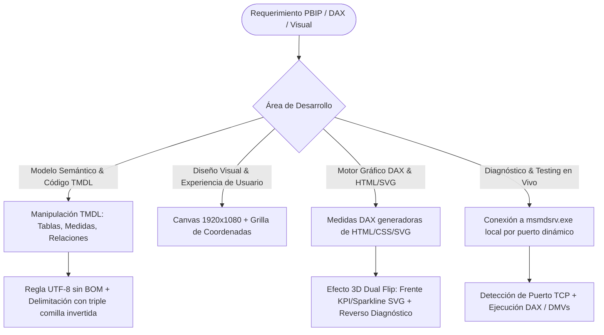

# Power BI Developer: PBIP, TMDL Engineering & DAX UI Engine

## Propósito y Alcance Operativo
Esta skill capacita al agente para desarrollar soluciones de Business Intelligence de vanguardia bajo el formato **Power BI Project (`.pbip`)**. Abarca la manipulación manual y compilación rigurosa de **TMDL (Tabular Model Definition Language)** en **UTF-8 sin BOM**, diseño de layouts milimétricos en canvas panorámico **1920x1080**, la creación de un motor visual en **DAX** que genera tarjetas KPI interactivas con **HTML, CSS puro y SVG nativo (incluyendo efecto 3D Dual Flip animado)** para storytelling ejecutivo, y la inspección en vivo de la instancia local de Analysis Services (`msmdsrv.exe`).

---

## 1. Árbol de Decisión Operativo



---

## 2. Flujo de Trabajo Metodológico (Paso a Paso)

### Fase 1: Ingeniería y Compilación Manual de TMDL
1. **Regla Crítica de Codificación (UTF-8 sin BOM):**
   - **ERROR FATAL DE AS:** Si un editor o script guarda un fichero `.tmdl` con encabezado BOM (`0xEF, 0xBB, 0xBF`), Analysis Services falla con error de sintaxis al abrir el proyecto en Power BI Desktop.
   - **MANDATORIO:** Todo archivo `.tmdl` debe ser guardado estrictamente en **UTF-8 puro sin BOM**.
2. **Sintaxis de Medidas Multilínea:**
   - Expresiones DAX complejas o con código HTML/SVG incrustado deben delimitarse estrictamente con **exactamente tres comillas invertidas** (```` ``` ````):
     ```tmdl
     measure 'Venta Neta' = ```
         CALCULATE(
             SUM(Ventas[ImporteNeto]),
             Ventas[Estado] = "Completado"
         )
         ```
         formatString: "$ #,##0.00"
     ```
3. **Estructura de Indentación:**
   - La jerarquía de TMDL se define por tabulaciones (`\t`). Las propiedades de una medida (`formatString`, `displayFolder`) deben tener un nivel adicional de sangría respecto a la declaración de la medida.

---

### Fase 2: Arquitectura de Canvas y Grilla Ejecutiva (1920x1080)
1. **Lienzo Panorámico HD:**
   - Resolución fija: **1920 px de ancho x 1080 px de alto**.
   - Proporción 16:9 optimizada para pantallas directivas y comités de gerencia.
2. **Distribución por Coordenadas Milimétricas:**
   - **Margen exterior uniforme:** 20 px en los 4 bordes.
   - **Cabecera superior (Header):** `x: 20`, `y: 20`, `ancho: 1880`, `alto: 70`.
   - **Fila de Tarjetas KPI superiores (4 tarjetas):**
     - Ancho por tarjeta: `455 px`, Alto: `160 px`, Gutter (espacio entre tarjetas): `20 px`.
     - Coordenadas Y: `110 px`.
   - **Sección Central de Análisis (2 visuales):**
     - Gráfico principal (Líneas/Áreas): `ancho: 1220 px`, `alto: 460 px`.
     - Gráfico complementario (Ranking): `ancho: 640 px`, `alto: 460 px`.
     - Coordenadas Y: `290 px`.
   - **Sección Inferior Detallada:**
     - Coordenadas Y: `770 px`, `alto: 290 px`.

---

### Fase 3: Motor Gráfico DAX con HTML, CSS y Efecto 3D Dual Flip
Para superar las limitaciones de las tarjetas estándar de Power BI, se generan cadenas de texto HTML/CSS dinámicas mediante medidas DAX, visualizadas con objetos visuales HTML certificados (ej. HTML Content / HTML Viewer):

1. **Estructura del Componente 3D Flip:**
   - **Contenedor Principal:** Configurado con `perspective: 1000px`.
   - **Elemento Giratorio (Card Inner):** Configurado con `transform-style: preserve-3d; transition: transform 0.6s ease;`.
   - **Frente (Front Face):** `backface-visibility: hidden;` muestra la métrica KPI principal, la variación porcentual vs período anterior y un **gráfico sparkline dinámico dibujado en SVG nativo** vía coordenadas DAX.
   - **Reverso (Back Face):** `backface-visibility: hidden; transform: rotateY(180deg);` muestra un **diagnóstico narrativo ejecutivo automatizado** en texto explicativo (insights, anomalías o causas detectadas por DAX).
2. **Interactividad:**
   - Activación por `:hover` en CSS o persistencia al clic mediante el patrón de `checkbox` oculto (`:checked ~ .card-inner`).

---

### Fase 4: Diagnóstico y Conexión en Vivo a Analysis Services Local
Cuando Power BI Desktop está abierto con un proyecto `.pbip` o `.pbix`, inicia internamente una instancia local del motor tabular de Analysis Services en el proceso `msmdsrv.exe`:

1. **Detección Automática de Puerto:**
   - El puerto TCP se asigna dinámicamente en cada inicio.
   - Script de detección vía PowerShell inspeccionando conexiones TCP asociadas al PID de `msmdsrv.exe`.
2. **Consultas de Diagnóstico:**
   - Conexión vía ADOMD.NET o Python (`pyadomd`) para ejecutar consultas DAX (`EVALUATE ...`) o inspeccionar Vistas de Administración Dinámica (DMVs como `$SYSTEM.TMSCHEMA_MEASURES`, `$SYSTEM.DISCOVER_MEMORYUSAGE`).

---

## 3. Antipatrones Críticos a Evitar

| Antipatrón | Consecuencia en el Proyecto | Corrección Mandatoria |
| :--- | :--- | :--- |
| **Guardar archivos `.tmdl` con UTF-8 BOM** | Error crítico en Analysis Services: el proyecto PBIP no compila. | Usar UTF-8 sin BOM (validar con `tmdl_bom_cleaner.py`). |
| **Usar comillas simples o dobles para medidas multilínea en TMDL** | Truncamiento de la fórmula DAX en saltos de línea. | Encapsular siempre en exactamente 3 comillas invertidas (```` ``` ````). |
| **Diseñar visuales sin coordenadas exactas** | Desalineaciones y asimetrías perceptibles en pantallas de alta resolución. | Fijar `x, y, width, height` de cada visual en la grilla 1920x1080. |
| **Generar SVG en DAX sin codificar caracteres especiales** | El navegador no renderiza el SVG si contiene caracteres no escapados como `#` en colores. | Reemplazar `#` por `%23` en cadenas `data:image/svg+xml`. |

---

## 4. Checklist de Validación Técnica

1. ¿Todos los ficheros `.tmdl` del directorio `.SemanticModel/definition/` están en UTF-8 sin BOM?
2. ¿Las medidas complejas multilínea en TMDL están delimitadas por ```` ``` ````?
3. ¿El canvas de la página está configurado en 1920x1080 con gutters uniformes de 20px?
4. ¿Las tarjetas HTML/SVG tienen configurada la propiedad `backface-visibility: hidden` para un giro limpio de 180°?
5. ¿Se verificó la compilación abriendo el PBIP en Power BI Desktop o validando la conexión al puerto de `msmdsrv.exe`?
