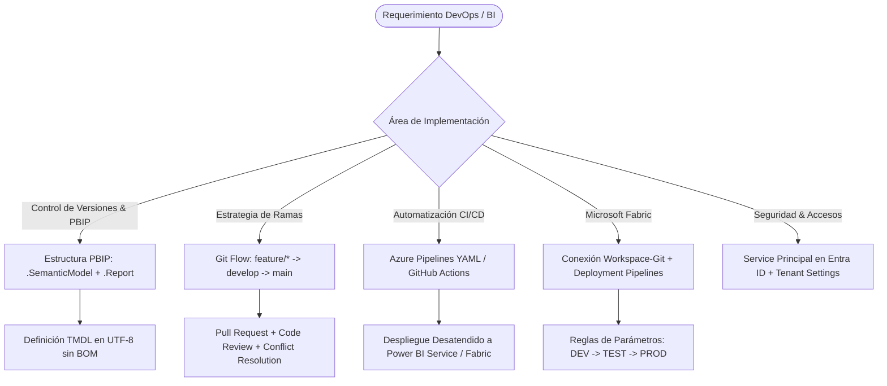

# Power BI DevOps & Microsoft Fabric Enterprise Lifecycle Management

## Propósito y Alcance Operativo
Esta skill capacita al agente para implementar prácticas modernas de **DevOps para Business Intelligence y Modelos Semánticos**, superando la era del archivo binario monolítico `.pbix`. Cubre la arquitectura del formato **Power BI Project (`.pbip`)**, control de versiones con Git (Git Flow adaptado a analítica), canalizaciones CI/CD automatizadas en **Azure DevOps** y **GitHub Actions**, autenticación desatendida mediante **Service Principals** en Microsoft Entra ID, integración nativa de Workspaces con Git en **Microsoft Fabric** y orquestación de **Deployment Pipelines** a través de entornos DEV, TEST y PROD.

---

## 1. Árbol de Decisión Operativo

---

## 2. Flujo de Trabajo Metodológico (Paso a Paso)

### Fase 1: Arquitectura del Formato Power BI Project (`.pbip`)
1. **Desacoplamiento Estructural:**
   - Un proyecto `.pbip` separa el modelo de datos de la capa visual en dos directorios independientes:
     - `<Nombre>.Report/`: Contiene `definition.pbir`, metadatos visuales y configuraciones de página.
     - `<Nombre>.SemanticModel/`: Contiene `definition.pbism` y la definición lógica del modelo tabular en formato **TMDL** o `model.bim`.
2. **Ventajas Colaborativas:**
   - Permite que un Data Engineer trabaje en medidas DAX y relaciones TMDL en el `.SemanticModel` mientras un BI Designer diseña gráficos en el `.Report` sobre la misma rama sin generar bloqueos binarios.

---

### Fase 2: Estrategia de Ramificación Git (Git Flow para BI)
1. **Jerarquía de Ramas:**
   - `main`: Refleja el código productivo desplegado en el Workspace de **PROD**. Prohibido hacer push directo (requiere Pull Request aprobada).
   - `develop` o `test`: Rama de integración continua conectada al Workspace de **TEST / UAT** para validación de usuarios clave.
   - `feature/<ticket-o-tarea>`: Ramas efímeras creadas por los desarrolladores desde `develop` para nuevas medidas, tablas o páginas de informe.
2. **Reglas de Pull Request (PR):**
   - Requiere revisión de pares (*code review*).
   - Validación automática de sintaxis y estructura PBIP mediante pipeline de CI.
   - Aprobación de pruebas de integración antes del merge.

---

### Fase 3: Autenticación Segura con Service Principals (Microsoft Entra ID)
1. **Registro de Aplicación en Entra ID (Azure AD):**
   - Crear un **App Registration** (Service Principal).
   - Generar un secreto de cliente (`Client Secret`) o credencial de certificado.
   - Guardar: `Application (Client) ID`, `Directory (Tenant) ID` y `Client Secret`.
2. **Habilitación en Power BI Admin Portal (Tenant Settings):**
   - Crear un Grupo de Seguridad (Security Group) en Entra ID que contenga el Service Principal.
   - En *Tenant settings > Developer settings*: Habilitar **"Allow service principals to use Power BI APIs"** exclusivamente para dicho grupo de seguridad.
3. **Asignación de Permisos en Workspaces:**
   - Asignar al Service Principal el rol de **Member** o **Admin** en los Workspaces de destino en Power BI / Fabric.

---

### Fase 4: Integración Nativa de Microsoft Fabric con Git
1. **Conexión de Workspace:**
   - En la configuración del Workspace de Fabric, seleccionar **Git integration**.
   - Conectar con Azure DevOps Repos o GitHub especificando Organización, Proyecto, Repositorio y Rama correspondiente:
     - Workspace DEV $\rightarrow$ Rama `feature/*` o `develop`.
     - Workspace TEST $\rightarrow$ Rama `develop` o `release/*`.
     - Workspace PROD $\rightarrow$ Rama `main`.
2. **Sincronización Bidireccional:**
   - **Source Control Status:** Indica si el workspace está sincronizado (*In sync*) o tiene cambios pendientes de commit hacia Git (*Uncommitted changes*) o cambios remotos por aplicar (*Incoming changes*).

---

### Fase 5: Deployment Pipelines (Canalizaciones de Implementación)
1. **Las 3 Etapas Canónicas:**
   - **Desarrollo (DEV):** Entorno de iteración de desarrolladores.
   - **Pruebas (TEST):** Validación funcional, performance y UAT con datos representativos.
   - **Producción (PROD):** Entorno de consumo directivo con alta disponibilidad y SLAs estrictos.
2. **Reglas de Despliegue (Deployment Rules):**
   - Configuración de parámetros dinámicos por entorno: Reemplazo automático del connection string de SQL o dataset de Fabric Lakehouse/Warehouse (ej. cambiar base de datos `dw_dev` a `dw_prod` al promover la etapa).

---

### Fase 6: Automatización CI/CD con Azure Pipelines (YAML)
1. **Pipeline de Integración Continua (CI):**
   - Disparador: Apertura de Pull Request contra `develop` o `main`.
   - Acciones: Linting, validación estructural del PBIP, verificación de codificación UTF-8 en TMDL y análisis de mejores prácticas de modelo.
2. **Pipeline de Entrega Continua (CD):**
   - Disparador: Merge a `develop` o `main`.
   - Acciones: Publicación desatendida vía Power BI REST API / Fabric APIs o disparo de la canalización de implementación con Service Principal.

---

## 3. Antipatrones Críticos a Evitar

| Antipatrón | Consecuencia Técnica | Corrección Mandatoria |
| :--- | :--- | :--- |
| **Controlar versiones con archivos binarios `.pbix`** | Imposible hacer merge o diff en Git; sobreescritura destructiva de trabajo ajeno. | Migración obligatoria al formato **PBIP**. |
| **Hacer commits directos sobre la rama `main`** | Desestabilización inmediata del entorno de Producción sin auditoría. | Bloquear la rama `main` en Azure Repos/GitHub con políticas de PR obligatorias. |
| **Usar cuentas de usuario personales en pipelines CI/CD** | Falla de autenticación cuando el usuario cambia de password o deja la empresa; ruptura de MFA. | Uso exclusivo de **Service Principals** en Microsoft Entra ID. |
| **Hardcodear credenciales en ficheros YAML o scripts** | Fuga grave de seguridad y exposición de secretos corporativos. | Almacenar secretos en **Azure Key Vault** o en variables secretas del pipeline. |
| **Conectar el Workspace de PROD a la rama `develop`** | Usuarios finales consumen reportes en desarrollo con métricas no probadas. | Vincular PROD estrictamente a la rama `main` o canalizaciones promovidas. |

---

## 4. Checklist de Auditoría DevOps para Power BI

1. ¿El proyecto está serializado en formato `.pbip` con estructura `.SemanticModel` y `.Report`?
2. ¿Existen ramas diferenciadas para desarrollo (`develop`), features y producción (`main`)?
3. ¿El Service Principal tiene permisos mínimos acotados únicamente a los workspaces necesarios?
4. ¿Las canalizaciones de implementación de Fabric tienen configuradas reglas de parámetros para aislar datos de DEV y PROD?
5. ¿El pipeline YAML de Azure DevOps valida las PRs de forma desatendida sin intervención manual?

