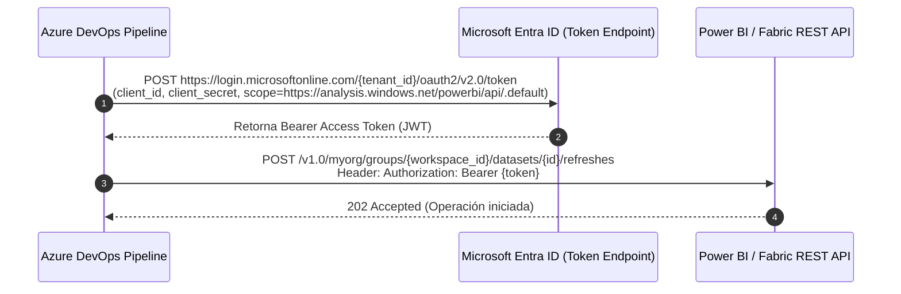

# Autenticación Desatendida con Service Principals en Azure DevOps & Fabric

Para que las canalizaciones CI/CD interactúen con Power BI Service y Microsoft Fabric sin intervención humana ni bloqueos por autenticación multifactor (MFA), es obligatorio utilizar **Service Principals** (identidades de aplicación en Microsoft Entra ID).

---

## 1. Flujo de Autenticación OAuth 2.0 (Client Credentials Flow)

---

## 2. Configuración en Microsoft Entra ID (Azure AD)
1. Ir a **Entra ID > App registrations > New registration**.
2. Nombre: `sp-powerbi-devops-automation`.
3. Tipo de cuenta: *Single tenant*.
4. Ir a **Certificates & secrets > Client secrets > New client secret** y guardar el `Value` (secreto generado).
5. Copiar el `Application (client) ID` y el `Directory (tenant) ID`.
6. Crear un **Security Group** en Entra ID (ej. `SG-PowerBI-ServicePrincipals`) y agregar como miembro la aplicación creada.

---

## 3. Habilitación en el Portal de Administración de Power BI (Tenant Settings)
1. Iniciar sesión como Power BI Administrator en `app.powerbi.com`.
2. Ir a **Admin portal > Tenant settings > Developer settings**.
3. Buscar **"Allow service principals to use Power BI APIs"**:
   - Estado: **Enabled**.
   - Aplicar a: **Specific security groups** $\rightarrow$ Seleccionar `SG-PowerBI-ServicePrincipals`.
4. Buscar **"Service principals can access read-only admin APIs"** si el pipeline requiere auditorías de inventario a nivel de organización.

---

## 4. Configuración en el Workspace de Destino
1. Abrir el Workspace de Fabric o Power BI.
2. Ir a **Workspace access**.
3. Buscar el nombre de la aplicación `sp-powerbi-devops-automation`.
4. Asignarle el rol de **Member** (suficiente para refrescar y desplegar) o **Admin**.

