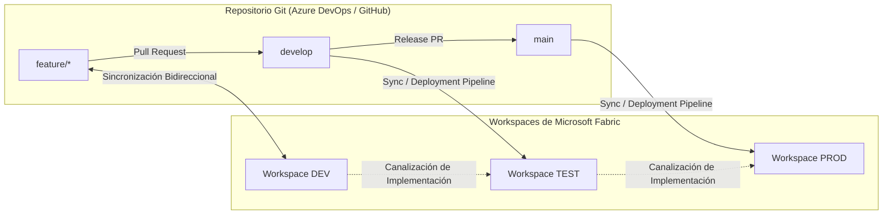

# Integración de Microsoft Fabric con Git y Deployment Pipelines

Microsoft Fabric integra de forma nativa el control de versiones con Azure DevOps y GitHub directamente en la interfaz del Workspace.

---

## 1. Topología de Ambientes y Ramas

---

## 2. Estados de Control de Código (Source Control Status)

En la barra de herramientas del Workspace de Fabric, el botón **Source Control** muestra tres posibles estados:

| Estado | Significado | Acción Requerida |
| :--- | :--- | :--- |
| **In Sync (Sincronizado)** | El Workspace refleja con exactitud el commit de la rama Git. | Ninguna acción. |
| **Uncommitted Changes** | Se crearon o modificaron reportes/modelos en la web de Fabric que no están en Git. | Seleccionar elementos, escribir mensaje de commit y pulsar **Commit to Git**. |
| **Incoming Changes (Actualizaciones entrantes)** | Un desarrollador hizo merge o push a la rama Git remota. | Pulsar **Update All** para sincronizar el Workspace con el nuevo código de Git. |

---

## 3. Deployment Pipelines (Canalizaciones de Implementación)

Las Deployment Pipelines de Fabric gestionan la promoción formal de artefactos entre entornos:

### Reglas de Despliegue de Parámetros (Deployment Rules)
Al promover un SemanticModel de **DEV a TEST** o de **TEST a PROD**, los orígenes de datos no deben apuntar a las bases de datos de desarrollo. Se configuran reglas de reemplazo automáticas:

1. **Parámetro `ServerName`:**
   - En DEV: `sql-dev.database.windows.net`
   - En PROD: `sql-prod.database.windows.net`
2. **Parámetro `DatabaseName`:**
   - En DEV: `lakehouse_dev`
   - En PROD: `lakehouse_prod`

Al activar la regla, Fabric reescribe el parámetro en el modelo promovido sin requerir modificaciones manuales de código M o conexiones.

