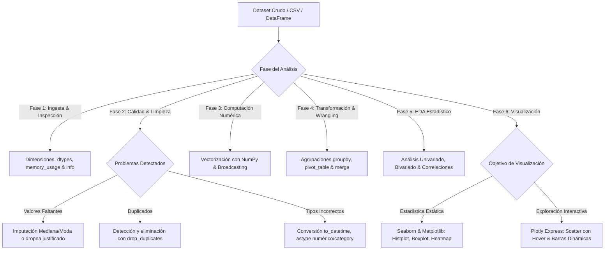

# Python Data Analytics & Exploratory Data Analysis (EDA)

## Propósito y Alcance Operativo
Esta skill capacita al agente para ejecutar análisis exploratorios de datos (EDA) rigurosos y pipelines de preparación analítica en entornos Python (Jupyter Notebooks, Google Colab y scripts estándar). Cubre computación matricial vectorizada con **NumPy**, tratamiento y limpieza avanzada con **Pandas** (detección de nulos, tipado, agregaciones `groupby` y `pivot_table`), análisis estadístico descriptivo univariado, bivariado y multivariado, y visualización científica con **Matplotlib**, **Seaborn** y **Plotly Express**.

---

## 1. Árbol de Decisión Operativo



---

## 2. Flujo de Trabajo Metodológico (Paso a Paso)

### Fase 1: Ingesta e Inspección Estructural
1. **Inspección Inicial de Integridad:**
   - Dimensiones con `df.shape`.
   - Diagnóstico de tipos de datos y uso de memoria con `df.info(memory_usage='deep')`.
   - Detección rápida de nulos por columna: `df.isnull().sum() / len(df) * 100`.
   - Inspección de primeras y últimas filas con `df.head()` y `df.tail()`.
2. **Resumen Estadístico Preliminar:**
   - Variables numéricas: `df.describe(percentiles=[0.05, 0.25, 0.50, 0.75, 0.95]).T`.
   - Variables categóricas: `df.describe(include=['object', 'category'])`.

---

### Fase 2: Limpieza y Curación de Datos (Data Wrangling)
1. **Tratamiento de Valores Faltantes (`NaN`):**
   - Si los nulos representan < 2% en variables de alta cardinalidad y no afectan el sesgo: eliminación controlada con `dropna()`.
   - Si representan un porcentaje mayor: imputar con la **mediana** para variables numéricas con sesgo, o con la **moda** para variables categóricas.
   - Documentar siempre la justificación del método de imputación.
2. **Conversión y Consistencia de Tipos:**
   - Fechas: Parseo obligatorio a `pd.to_datetime(col, errors='coerce')` extrayendo componentes temporales (`year`, `month`, `day_name`).
   - Categóricas de baja cardinalidad: Conversión a tipo `category` para reducir consumo de RAM hasta un 80%.
   - Numéricas con caracteres parásitos: Limpieza con `.str.replace()` antes del casteo a `float` o `int`.
3. **Manejo de Duplicados:**
   - Identificar duplicados totales (`df.duplicated().sum()`) y por clave de negocio (`subset=['transaccion_id']`).

---

### Fase 3: Computación Numérica y Vectorización con NumPy
1. **Regla de Rendimiento:**
   - **PROHIBIDO:** Usar bucles `for` tradicionales o iterar con `.iterrows()` para cálculos columnares.
   - **OBLIGATORIO:** Usar operaciones vectorizadas nativas de NumPy o expresiones columnares de Pandas:
     ```python
     # Vectorización eficiente con np.where
     df['categoria_precio'] = np.where(df['precio'] >= 100, 'Premium', 'Estándar')
     ```
2. **Broadcasting y Operaciones Matriciales:**
   - Normalización Min-Max o Z-Score vectorizada:
     ```python
     z_scores = (df['valor'].to_numpy() - np.mean(df['valor'])) / np.std(df['valor'])
     ```

---

### Fase 4: Agrupaciones y Transformaciones Avanzadas
1. **Agregaciones Múltiples con `groupby().agg()`:**
   - Agregación por diccionario para cálculo simultáneo de métricas:
     ```python
     df.groupby('categoria').agg(
         ventas_totales=('monto', 'sum'),
         ticket_promedio=('monto', 'mean'),
         ticket_mediano=('monto', 'median'),
         clientes_unicos=('cliente_id', 'nunique')
     ).reset_index()
     ```
2. **Modelado Bidimensional con `pivot_table()`:**
   - Tablas de contingencia y cruces de variables con totales marginales (`margins=True`).
3. **Combinación de Fuentes (`merge` & `concat`):**
   - Joins explícitos con `pd.merge(df1, df2, on='key', how='inner')`, verificando cardinalidad antes y después del cruce.

---

### Fase 5: Análisis Exploratorio de Datos (EDA)
1. **Análisis Univariado:**
   - Variables numéricas: Distribución, asimetría (skewness), curtosis, histogramas con estimación de densidad de kernel (KDE) y boxplots para outliers.
   - Variables categóricas: Frecuencias absolutas y relativas con `value_counts(normalize=True)`.
2. **Análisis Bivariado:**
   - Numérica vs Numérica: Gráficos de dispersión (Scatter plot) y cálculo de coeficientes de correlación:
     - **Pearson:** Para relaciones lineales continuas con distribución normal.
     - **Spearman:** Para relaciones monótonas no lineales o en presencia de outliers severos.
   - Categórica vs Numérica: Diagramas de caja (Boxplots) o violín por grupo para comparar distribuciones.
3. **Análisis Multivariado:**
   - Heatmap de matriz de correlación triangular (eliminando el espejo superior redundante).
   - Gráficos de dispersión interactivos con codificación de color, tamaño y hover data en Plotly.

---

## 3. Antipatrones Críticos a Evitar

| Antipatrón | Consecuencia Técnica | Corrección Mandatoria |
| :--- | :--- | :--- |
| **Iterar con `.iterrows()` o bucle `for`** | Pérdida catastrófica de rendimiento ($100\times$ más lento). | Usar operaciones vectorizadas de Pandas / NumPy o `.apply()` vectorizado. |
| **Ignorar la advertencia `SettingWithCopyWarning`** | Modificación impredecible en vistas en lugar de copias reales. | Usar `.loc[mascara, 'columna'] = valor` o `.copy()`. |
| **Imputar con la media en datos sesgados** | Distorsión artificial de la varianza y sesgo en las conclusiones. | Usar la **mediana** o imputación por k-NN según el caso. |
| **Generar matriz de correlación completa redundante** | Sobrecarga visual con valores duplicados y diagonal 1.0. | Usar máscara booleana (`np.triu()`) en Seaborn para mostrar solo la mitad inferior. |
| **Guardar CSVs con índice numérico innecesario** | Crea columnas residuales `Unnamed: 0` al reabrir el archivo. | Especificar siempre `df.to_csv('salida.csv', index=False)`. |

---

## 4. Checklist de Validación de un EDA

1. ¿Se evaluaron los tipos de datos asegurando que las fechas sean `datetime64` y no `object`?
2. ¿Se identificaron y cuantificaron los valores nulos con su porcentaje sobre el total?
3. ¿Se verificó la existencia de outliers mediante rango intercuartílico (IQR) y boxplots?
4. ¿Se utilizó el coeficiente adecuado de correlación (Spearman ante distribuciones no normales)?
5. ¿Los gráficos tienen títulos claros, nombres de ejes con unidades y leyendas interpretables?

