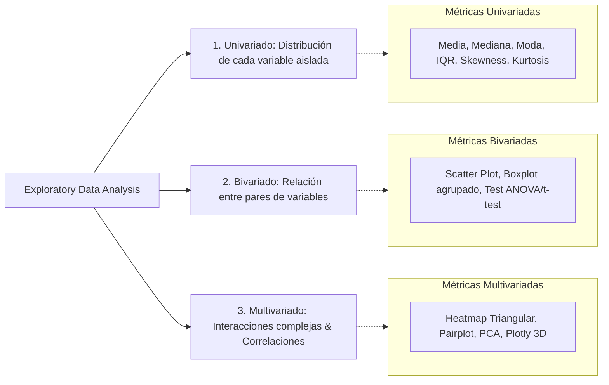

# Metodología y Framework Estadístico de EDA (Exploratory Data Analysis)

El Análisis Exploratorio de Datos es la disciplina rigurosa de interrogar los datos antes de proponer cualquier modelo de machine learning o tomar decisiones comerciales.

---

## 1. Las Tres Etapas del Análisis Exploratorio

---

## 2. Coeficientes de Correlación: Pearson vs Spearman

Elegir el coeficiente equivocado puede llevar a concluir erróneamente que no existe relación entre dos variables.

| Criterio | Correlación de Pearson ($r$) | Correlación de Spearman ($\rho$) |
| :--- | :--- | :--- |
| **Tipo de relación que evalúa** | **Lineal estricta** ($Y = mX + b$). | **Monótona** (cuando una variable crece, la otra también, sin importar si es una curva). |
| **Supuesto de distribución** | Requiere normalidad aproximada (Campana de Gauss). | No paramétrica (libre de supuestos distributivos). |
| **Sensibilidad a Outliers** | **Extremadamente sensible:** Un único outlier puede inflar o colapsar el coeficiente. | **Robusta:** Opera sobre los rangos (orden relativo) de los datos, no sobre sus valores absolutos. |
| **Cuándo usar** | Variables continuas normalmente distribuidas sin outliers severos. | Datos con asimetría pronunciada, escalas ordinales o presencia de atípicos. |

---

## 3. Asimetría (Skewness) y Diagnóstico de Curvas

- **Asimetría = 0:** Distribución simétrica (Media $\approx$ Mediana $\approx$ Moda).
- **Asimetría Positiva ($> 0$, Sesgo a la derecha):** La cola se extiende hacia valores altos (típico en ingresos, precios, tiempos de espera).
  - *Implicación:* La media se ve arrastrada hacia la derecha. **Se debe utilizar la mediana** como medida representativa.
- **Asimetría Negativa ($< 0$, Sesgo a la izquierda):** La cola se extiende hacia valores bajos (típico en edad de jubilación o calificaciones de exámenes fáciles).

