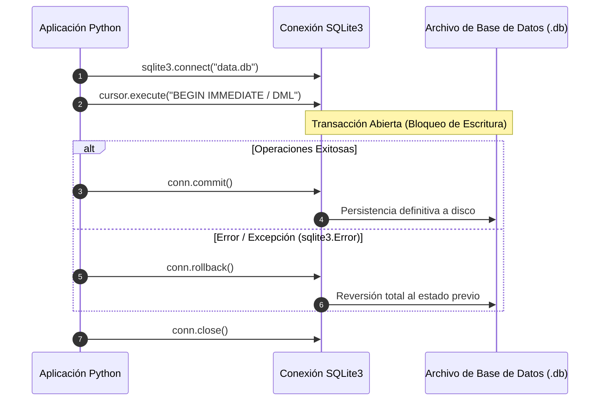

# Guía de Transaccionalidad y Manejo Robusto en SQLite3

SQLite3 es un motor de base de datos embebido ACID (Atomicidad, Consistencia, Aislamiento y Durabilidad). Comprender su ciclo transaccional es fundamental para evitar bloqueos y corrupción de datos.

---

## 1. El Ciclo de Vida Transaccional ACID



---

## 2. Habilitación de Claves Foráneas (Foreign Keys)
Por compatibilidad con versiones antiguas, SQLite3 **desactiva las Foreign Keys por defecto**. Es mandatorio activarlas inmediatamente después de abrir la conexión:

```python
import sqlite3

conn = sqlite3.connect("empresa.db")
conn.execute("PRAGMA foreign_keys = ON;")
```

---

## 3. Patrón Estándar de Context Manager para Transacciones

### Opción A: Usando `with conn:` (Commit Automático en Bloque)
Cuando se usa la conexión como un context manager, Python hace `commit()` automáticamente al salir del bloque sin errores, o `rollback()` si ocurre una excepción:

```python
import sqlite3

def transferir_fondos(db_path: str, origen_id: int, destino_id: int, monto: float):
    conn = sqlite3.connect(db_path)
    conn.execute("PRAGMA foreign_keys = ON;")
    try:
        with conn:  # Gestiona automáticamente la transacción
            cursor = conn.cursor()
            # 1. Debitar cuenta origen
            cursor.execute(
                "UPDATE cuentas SET saldo = saldo - ? WHERE id = ? AND saldo >= ?",
                (monto, origen_id, monto)
            )
            if cursor.rowcount == 0:
                raise ValueError("Fondos insuficientes o cuenta origen inexistente.")
            
            # 2. Acreditar cuenta destino
            cursor.execute(
                "UPDATE cuentas SET saldo = saldo + ? WHERE id = ?",
                (monto, destino_id)
            )
    except Exception as e:
        # El rollback ya ocurrió automáticamente dentro del with conn
        print(f"Transacción abortada: {e}")
        raise
    finally:
        conn.close()
```

---

## 4. Uso de `sqlite3.Row` para Acceso Nombrado a Columnas

Por defecto, SQLite3 retorna tuplas sin nombres de columnas (`(1, 'Notebook', 1200.0)`). Configurando `row_factory`, se pueden tratar los resultados como registros mapeados:

```python
conn.row_factory = sqlite3.Row
cursor = conn.cursor()
cursor.execute("SELECT id, nombre, precio FROM productos WHERE id = ?", (1,))
fila = cursor.fetchone()

if fila:
    print(f"Producto: {fila['nombre']} - Precio: ${fila['precio']:.2f}")
    # También soporta acceso por índice posicional:
    print(f"ID: {fila[0]}")
```

---

## 5. Inserciones Masivas de Alto Rendimiento: `executemany`
En lugar de iterar con `execute()` en un bucle (que reabre transacciones individuales lentas), se utiliza `executemany()` dentro de una sola transacción:

```python
registros = [
    ("Notebook Dell", 1200.50, 10),
    ("Mouse Ergonómico", 35.00, 50),
    ("Teclado Mecánico", 85.00, 25)
]

with conn:
    cursor.executemany(
        "INSERT INTO productos (nombre, precio, stock) VALUES (?, ?, ?)",
        registros
    )
```

